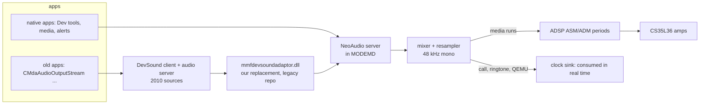

<!-- SPDX-License-Identifier: Apache-2.0 -->
# Audio: NeoAudio, media on the ADSP, and the old apps' DevSound

Started 2026-11-17 (research: `private/audio/codex-audio-report-20261117.md`, a Codex review with line-level
references into the 2010 sources). Continues [driver-support.md](driver-support.md) D3 and
[legacy.md](legacy.md) L2.

## What there was

Call audio (telephony C6/C7) and the ringtone work on the Pixel:

| Part | Chip | Before this work |
|---|---|---|
| Earpiece (top) | Cirrus CS35L36 at I2C10 0x40 ("Top") | calls, Dev tools loopback |
| Loudspeaker (bottom) | CS35L36 at 0x41 ("Bottom") | call Speaker, ringtone, loopback; "speaker" drives **both** amps with the same mono slot |
| Main mic | a DMIC through a Realtek RT5514 (I2C 0x57) | calls, loopback; DMIC1 left only (C1's mixer) |
| Second mic | the RT5514's other DMIC inputs | unused; which one is the top mic is not known |
| RT5514 on SPI | the always-on voice-wake DSP | unused, not needed |
| 3.5 mm jack | PM660L analog codec + the SDM660 digital codec | only MIC BIAS 1 (the DMIC's supply); no output, detection or buttons |
| Amp protection | CS35L36 IRQs (TLMM 79/80) | ignored; faults logged at start |
| Calibration | ACDB | none: the ADSP's built-in topologies |

MODEMD's APR ([telephony.md](telephony.md) C6) ran three things: the call's voice path, the loopback test and a
2-second ringtone looped from one 256 KB DMA region. No app could play or record sound; the old apps' DevSound had
no server (Frozen Bubble ran silent, [legacy.md](legacy.md)).

## Design

- **NeoAudio lives in MODEMD** because MODEMD owns the ADSP's APR channel (one receive owner per kernel ring). The
  logic is its own crate (`telephony/crates/neoaudio`), so a later AUDIOD (or the `neohw` split) takes it as is.
- **One session = one stream.** Any rate 8–96 kHz, mono or stereo, S16LE. Each stream has a 250 ms queue; WRITE
  waits while it is full (flow control); an underrun is counted once per dry spell (DevSound reports the end of
  data that way).
- **Software mixing first:** every stream is resampled (linear) to 48 kHz, mixed to mono with its volume, and
  saturated. One ADSP stream plays the mix. ADSP-side mixing (several ASM sessions) is a later option once proven.
- **Media on the ADSP:** `apr::Mode::Media` runs the ringtone's ASM/ADM path without the loop: eight 20 ms periods
  (1920 bytes each) after the ringtone in the same region, each published to the ADSP with its own kernel ticket
  and released by its own WRITE_DONE. Leaving media waits for the periods in flight (at most 1 s).
- **Priority:** call > ringtone > loopback test > media. While preempted, streams keep running on the clock sink
  (unheard) and INFO reports `PREEMPTED`, so players keep their pace and native players can pause.
- **The clock sink** consumes the mix in real time whenever the ADSP does not play it: no audio DSP (QEMU), a call,
  the ringtone, or a media start that has not reached the ADSP within 3 s. While media is starting the streams wait
  instead, so the start of a sound is not lost.
- **QEMU:** MODEMD no longer exits without a modem: it serves NeoAudio on the clock sink and refuses NeoModem
  connections (KErrNotFound), as if NeoModem were absent. `syborg-virtio-audio` is an unimplemented device in our
  QEMU board, so nothing is audible there.

### Kernel

- **AudioMem** (HAL 0x4e26) publishes **ranges**: up to 16 at once, each with a ticket and the ADSP generation;
  copies refuse a published range; publishing length 0 is the whole region (the ringtone). Op 4 copies out
  (recording). A successful ADSP stop frees every range.
- **Routes** (HAL Audio op 3): 0 earpiece (Top), 1 both amps, 2 bottom only (new).

### NeoAudio protocol (v1.0)

| Op | Args | Result |
|---|---|---|
| 1 OPEN | rate, channels, flags (1 = record) | 0; KErrInUse if the session has a stream |
| 2 WRITE | des8 PCM (whole frames) | bytes, once all are queued; waits while full |
| 3 READ | writable des8 | bytes, once full (or at STOP) |
| 4 VOLUME | 0..=100 | stream gain |
| 5 PAUSE | 1 / 0 | the queue is kept |
| 6 STOP | — | drops the queue; a waiting WRITE gets KErrCancel |
| 7 INFO | writable des8 (24 bytes) | state, sink, queued bytes, frames, underruns, overruns |
| 8 ROUTE | 0 both speakers, 1 earpiece, 2 bottom | media's route |
| 9 MASTER | 0..=10 | media's amp volume |

## Stages

| Stage | What | Check |
|---|---|---|
| **A0** | This page; the protocol | — |
| **A1** | NeoAudio in MODEMD with the clock sink; Dev tools tests | QEMU: Dev tools → Audio → "NeoAudio: play a tone" logs `done in ~3000 ms`, sink clock |
| **A2** | Media periods on the ADSP; per-range AudioMem; preemption | Pixel: the tone is heard on the loudspeaker; "two tones mixed"; routes (both / bottom / earpiece); a call or the ringtone during a tone; `sink dsp`, no underruns before the end |
| **A3** | Old apps: our `mmfdevsoundadaptor.dll` over NeoAudio, the audio server and its launcher | Frozen Bubble plays its sounds; exits and restarts cleanly |
| **A4** | Tones and DTMF (DevSound tone mode), WAV through the MMF controller | tone utility and a WAV file play |
| **A5** | Recording: ASM read from the mic port, the input stream | record 60 s, play it back; find the top mic |
| **A6** | Volume keys and settings for media, routes in Settings, focus rules | media → call → media |
| **A7** | Amp fault IRQs (mute and report), bottom/earpiece use, optional ADSP mixing, optional QEMU audio device | |
| **A8** | 3.5 mm jack (output, detection, headset mic, buttons), ACDB calibration investigation | |

## Status

- 2026-11-17: A0–A2 implemented on branches `audio` (telephony, kernel, neoui); host tests and ARM builds pass.
- 2026-11-17: A5 recording (`apr::Mode::Duplex`: the mic's AFE port, ASM read session 0x0201, ADM TX COPP from
  PRIMARY_TDM_TX, eight 20 ms read buffers at 0x34000; kernel AudioMem op 4 copies them out), A6 Settings → Sound →
  Media (media volume, where media plays, microphone, "Test sound", "Record and play back"; the volume keys set the
  media volume outside a call), A7 amp protection polling (kernel op 7, MODEMD every 250 ms) and the mic choice
  (op 6: DMIC1/DMIC2, to find the top mic). Phone round 2 next.
- In progress: A3 (our `mmfdevsoundadaptor.dll`, the server launcher, the server DLLs; `legacy/audio`), A4 (the
  WAV controller closure), A8 (the 3.5 mm jack: kernel `a64_jack.cpp` with polled detection, the headphone and
  headset-mic paths; the ADSP's internal MI2S ports in APR).
- Not planned: an audible QEMU device (our board's `syborg-virtio-audio` is unimplemented and VNC carries no
  sound); ACDB calibration (a proprietary format; the ADSP's built-in topologies stay) — both recorded as gaps.
