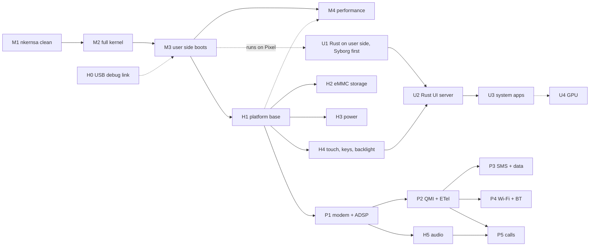

# Roadmap: EKA2 on the Pixel 3a XL, to a daily phone with a Rust UI

Written 2026-11-05. It continues `port-map.md`, which plans the first milestone in detail, and goes all the way to a
phone you can use every day.

- Sizes and durations marked **GUESS** are estimates.
- Hardware facts marked **DTB** come from the device tree appended to `probes/out/probe-a64.img` (model "Google Pixel 3a
  XL (with SDC panel)"; it uses mainline-Linux-style `qcom,sdm670-*` compatibles). To dump it, find the `d00dfeed`
  magic in the image, then run `dtc -I dtb -O dts`.
- Anything else marked **unverified** has not been checked.

## Goal and fixed decisions

**Goal:** a daily phone: calls, SMS, mobile data, Wi-Fi, a touch UI, and a battery that lasts a day.

| Decision | Made by | Choice |
|---|---|---|
| Kernel | existing | The 2010 SMP EKA2 (kernelhwsrv `201043_12`), as an ILP32 AArch64 kernel (`port-map.md`). |
| User side | user | Keep the 2010 Symbian user side, built 32-bit ARM by Phorepoc and run unchanged at AArch32 EL0: file server, servers, eshell, old apps. |
| UI | user | A **new Rust UI server** replaces the old window server and UI. The system apps are written in Rust. |
| Driver language | user: "a mix"; the split is **my call** | See next section. |
| Hardware reference | **my call** | Mainline Linux (sdm670/sdm845), postmarketOS and freedreno are read for register layouts and protocol behaviour only. No code is copied from them (GPL vs EPL/Apache). |

## Driver language split (my call)

The kernel is ILP32: 64-bit code with 32-bit pointers. Rust has no ILP32 AArch64 target, so Rust code can't be linked
into the kernel safely. That gives one rule:

> **Timing-critical code, or anything needed before the user side boots → C++ in the kernel.
> Protocol logic and policy → Rust on the user side.**

| Layer | Language | Examples |
|---|---|---|
| Kernel drivers (EKA2 LDD/PDD) | C++ | GIC and timers (done), clocks and regulators over RPMh, SPMI to the PMICs, GENI I2C/SPI, GPI DMA, SDHCI/eMMC media driver, DWC3 USB, DSI panel and backlight power, SCM calls to TrustZone, remote-processor loader, GLINK/SMEM transport |
| Generic `hwaccess` LDD | C++ (small) | Gives a user-side Rust driver a mapping of a register block and an interrupt-to-request notification. It exists so most new drivers don't need kernel code. |
| User-side drivers and stacks | Rust (`armv7a-none-eabihf`, `no_std` + `e32` crate) | Synaptics RMI4 touch protocol, battery and charger policy, QMI client, modem and telephony logic, Wi-Fi control, the UI server, all system apps |
| Glue to old Symbian frameworks | thin C++ | ETel TSY plugin over Rust QMI; ESOCK/TCPIP6 packet interface over the modem and Wi-Fi data paths |

Rust user-side code can be unit-tested on a PC: protocol parsers, QMI, UI layout. Kernel C++ is tested on QEMU first,
then on the phone.

## Hardware inventory (what each stage talks to)

| Block | Where | Status |
|---|---|---|
| CPUs: 8 cores, MPIDR Aff1 0–7, PSCI over SMC | `board/pixel_bonito.cpp` | **working** |
| GICv3 at `0x17a00000` / `0x17a60000`, virtual timer PPI 19 | same | **working** |
| Framebuffer: continuous splash at `0x9c000000`, 1080×2160 a8r8g8b8 | same, `probes/README.md` | **working** (left on by the bootloader) |
| RAM: `memory@80000000` | DTB (the bootloader fills in the size) | Size and ranges **unverified**. Expect 4 GB from `0x80000000`, so about 2 GB sit below the 4 GB physical limit of the 32-bit `TPhysAddr`. |
| Storage: **eMMC**, `qcom,sdm670-sdhci` (sdhci-msm-v5, CQHCI, ICE) at `0x7c4000` | DTB | no driver |
| Touch: **Synaptics RMI4** on I2C, address `0x20` | DTB | no driver |
| PMICs: **PM660** (charger, RRADC, GPIO, regulators, haptics) and **PM660L** (GPIO, WLED backlight, LPG, flash LED, WCD analog codec) on SPMI at `0xc440000` | DTB | no driver |
| Display: MDSS / DPU / DSI controllers | DTB | splash only |
| USB: DWC3 + QUSB2 PHY | DTB | no driver |
| Modem: `remoteproc@4080000` `qcom,sdm670-mss-pil`, firmware `qcom/sdm670/sargo/mba.mbn` + `modem.mbn`, GLINK edge, SMEM at `0x86000000` | DTB | no driver |
| ADSP (audio DSP) memory at `0x95800000`, LPASS SMP2P; CDSP at `remoteproc@8300000` | DTB | no driver |
| GPU: **Adreno 615** + GMU, own SMMU | DTB | no driver |
| Bluetooth: `qcom,wcn3990-bt` | DTB | no driver |
| **Wi-Fi: not in this DTB** | DTB | **unverified**. WCN3990 Wi-Fi on SDM845-family chips is normally driven via the modem subsystem and QMI. |

## Tracks and stages

Four tracks. Track K runs alone until M3. After that, H, U and P run in parallel.

### Track K: kernel

**M1: nkernsa clean on the phone** (in progress)
- Work: fix the 4 remaining TT2 timeslice failures (`7fe0958`). Finish the idle and balancing work (`2e08ec8`, `dafbc87`).
- Exit: full nkernsa suite with **0 failures** on the phone. QEMU passes everything except the timing checks QEMU can't
  meet (its vCPUs don't advance in lockstep).

**M2: full kernel (`ekern`) on QEMU, then on the phone**
- Work, from `port-map.md` §2–§4 and §7:
  - exec gate: read the SVC opcode with `LDTR` at `ELR_EL1-4`; bit 23 = fast/slow; Thumb SVC has an 8-bit immediate;
  - `umemget`/`umemput`, `TExcTrap`, `EpocThreadFunction`, user entry;
  - flexible memory model on VMSAv8 with ASIDs and IPC alias redesign;
  - AArch32-EL0 fix-ups ported from Phorepoc `ekern_seam.cpp:1162-1603` (SWP/SWPB, misaligned LDRD/STRD/LDM/STM, VFP
    short vectors).
- Reuse: Phorepoc x86-64 ekern backend as the template (`xe_kernel.cpp`, `xe_mmu.cpp`, `xk_irq.cpp`).
- Size: ~3–5k new lines (**GUESS**, `port-map.md` §7).
- Exit: e32test core groups pass on QEMU and on the phone.

**M3: user side boots**
- Work:
  - ROM image from Phorepoc's 32-bit ARM user side (the pdk tools are on ZimaOS);
  - file server on a RAM drive;
  - eshell (FShell later) on the framebuffer console;
  - a temporary input path: volume keys as GPIO, or text over the USB serial link from H0.
- Exit: a shell prompt on the phone screen; basic f32test runs.
- Repos: when the user side is built with `phe`, split this repo Phorepoc-style. The arm64 port and the Qualcomm
  drivers go into a SoC repo (`adaptation-sdm670`), and the Pixel settings and image recipes into a board repo
  (`board-bonito`), both under `neosymbian`.

**M4: performance** (any time after M3)
- **big.LITTLE-aware balancing** in `nkernsmp/nk_bal.cpp`: 2 gold + 6 silver cores. Busy threads go to gold, background
  work to silver.
- **LSE atomics** (ARMv8.1+ `CAS`/`LDADD`) in `a64s_atomics.cpp` instead of LDXR/STXR loops.
- **Tickless idle**: don't wake idle cores every 1 ms.
- **CPU frequency scaling** through the SoC's cpufreq hardware block (needs H1).
- **More than 4 GB physical**: widen `TPhysAddr` to 64 bits in the memory model. Only if the RAM map (unverified)
  puts memory we need above 4 GB.
- Exit: before/after numbers from the nkernsa benchmarks, boot time, and idle current.

### Track H: hardware

| Stage | Work | Exit |
|---|---|---|
| **H0 debug link** (early, ideally before M3) | DWC3 in device mode as a USB serial console, so logs leave the phone without the screen | Kernel logs readable on the Mac over USB |
| **H1 platform base** | RPMh (clocks, regulators, bus votes), SPMI PMIC arbiter, TLMM GPIO, GENI I2C/SPI, GPI DMA, SCM calls to TrustZone | Can talk to PM660 and to an I2C device |
| **H2 storage** | SDHCI-msm eMMC media driver (CQHCI later), read Android's GPT, a Symbian FAT drive on a spare or repurposed partition | Files written in Symbian survive a reboot |
| **H3 power** | PM660 charger + RRADC battery reading (Rust policy); suspend and resume (PSCI CPU_SUSPEND / system suspend); screen off | Phone idles a night on battery and wakes on the power key |
| **H4 display + input** | Synaptics RMI4 touch (I2C, Rust protocol code behind `hwaccess`); power and volume keys; WLED backlight on PM660L; DSI panel on/off. Keep the bootloader's splash framebuffer as scan-out until a DPU driver is needed. | Touch coordinates reach a user-side process; backlight dims |
| **H5 audio** | ADSP remote processor; audio path through LPASS + PM660L WCD codec; speaker and earpiece | Play a tone through the earpiece |
| **H6 haptics, LEDs, sensors** | PM660 haptics, LPG and flash LED, sensors (**unverified** which) | Vibrate on touch |

### Track U: Rust UI

The full plan is in [rust-integration.md](rust-integration.md) (phases R0–R7). It is developed now on QEMU Syborg,
with the real 2010 ARM user side, and moves to the Pixel after M3.

**U1: Rust on the Symbian user side** (now on Syborg; on the Pixel after M3) = R0–R3
- Build path:
  - target **`armv5te-none-eabi`**, soft-float, matching the user side's `-march=armv5te` ABI. **Never `eabihf`:** it
    passes floats differently and breaks calls into Symbian libraries;
  - Rust staticlib → link with symbian-2010's toolchain → its emitter (ELF → E32Image from the frozen `.def` files)
    → E32 image in the ROM.
- `e32` crate:
  - raw exec calls (`svc` with the fast/slow bit);
  - a global allocator on an `RHeap` or a chunk;
  - threads, semaphores, timers;
  - IPC client and server (`RSessionBase`/`CServer2` equivalents with a Rust API);
  - descriptor conversion at the boundary.
- Exit: a Rust "hello" EXE runs from eshell, and a Rust server answers a C++ client.

**U2: Rust UI server** (R4–R6 on the Mac and Syborg now; on the Pixel = R7, needs U1 + M3 + H4)
- Owns the framebuffer and touch input; replaces the old window server.
- Apps draw into their own shared chunks; the server composites with damage tracking, then does a CPU copy to the
  splash framebuffer. Shared chunks are the EKA2 equivalent of shared memory.
- Apps talk to it over Symbian IPC: create surface, input events, focus, notifications.
- UI toolkit: **Slint** with its CPU-only software renderer (needs no GPU or operating system).
- Exit: a Rust launcher drawn and scrollable by touch. Target 60 fps at 1080×2160; measure it, CPU only.

**U3: system apps in Rust**
- Launcher, status bar (battery from H3, signal from P2), settings, dialer, messages, contacts, file manager.
- Old Symbian text apps keep running from a terminal app.

**U4: GPU** (stretch)
- Adreno 615 + GMU + its SMMU. Kernel part in C++; command-stream builder in Rust. Freedreno is the reference.
- Until then, everything renders on the CPU.

### Track P: phone

**P1: remote processors** (needs H1)
- Start the modem (MSS) through TrustZone: load and authenticate `mba.mbn` + `modem.mbn` from the phone's own firmware
  partitions, then the ADSP (also needed for H5).
- GLINK over SMEM + SMP2P. QRTR router.
- Exit: the modem reports "ready" and answers a QRTR ping.

**P2: QMI in Rust**
- QMI framing and the services: control, DMS (device), NAS (network), UIM (SIM), WDS (data), WMS (SMS), VOICE.
- Behind a thin C++ **ETel TSY**, so Symbian's own telephony API keeps working. Which ETel packages are in Phorepoc's
  build is **unverified**; check this first.
- Exit: status bar shows the operator name and signal bars.

**P3: SMS and mobile data**
- SMS: QMI WMS, through the Symbian SMS stack if it is present in the build (**unverified**), otherwise a Rust messages
  service.
- Data: the modem's IP data path (IPA hardware, `qcom,sdm670-ipa`) into ESOCK/TCPIP6 as a packet interface.
- Exit: send and receive an SMS; fetch a web page over LTE.

**P4: Wi-Fi + Bluetooth**
- WCN3990: Wi-Fi is managed through the modem subsystem and QMI on this chip family (**unverified for sdm670; not in
  the DTB**), so it comes after P1/P2. Data goes into ESOCK.
- Bluetooth over its UART (`qcom,wcn3990-bt`).
- Exit: join a WPA2 network.

**P5: voice calls**
- QMI VOICE + audio routing from H5.
- **Go/no-go risk for "daily phone":** most networks have switched off 2G/3G, so calls need **VoLTE/IMS**. On Qualcomm
  Android, IMS is a closed user-space stack. An open IMS path on this modem may not exist.
- Check this first, on your own carrier:
  1. does the network still allow 2G/3G voice;
  2. how far postmarketOS on sdm670/sdm845 has got with VoLTE.
  If both answers are no, calls are out of reach and the goal becomes "data + SMS + VoIP".
- Exit: make and receive a call with two-way audio.

## Dependencies

## Suggested order and checkpoints

| # | Stages | You can now… |
|---|---|---|
| 1 | M1 → M2 → H0 → M3 | type commands into a Symbian shell on the phone |
| 2 | U1 → H1 → H2 → H4 → U2 | use a touch-driven Rust launcher, with files that persist |
| 3 | H3 → M4 → U3 | leave it on battery all day; everything feels fast |
| 4 | P1 → P2 → P3 | see signal, send SMS, browse over LTE |
| 5 | P4 → H5 → P5 | use Wi-Fi, hear audio, and make calls (if the VoLTE risk allows) |
| — | U4 | GPU acceleration, any time after checkpoint 3 |

## Unverified: check before the stage that needs it

| Question | Needed for | How to check |
|---|---|---|
| RAM ranges and size (the DTB leaves the size to the bootloader) | M2 memory map, M4 | Dump the DTB the bootloader passes at boot (x0) on the phone |
| Which Phorepoc user-side packages exist and build: ETel, SMS stack, ESOCK/TCPIP6, FShell | M3, P2, P3 | List the Phorepoc ROM contents / build recipes on ZimaOS |
| WCN3990 Wi-Fi on sdm670: firmware path and control path | P4 | Mainline sdm845 DTBs + postmarketOS notes for sargo/bonito |
| VoLTE feasibility on the target carrier | P5 go/no-go | Carrier's 2G/3G status; postmarketOS VoLTE status on Qualcomm |
| Sensors present on bonito | H6 | Full DTB from the bootloader / stock kernel |
| Rust `armv7a-none-eabihf` objects linking through the Symbian toolchain and `elf2e32` | U1 | A one-function spike before the `e32` crate |
| Slint software renderer speed at 1080×2160 on one Kryo core | U2 | Benchmark on Linux on similar ARM hardware, or on the phone after U1 |
