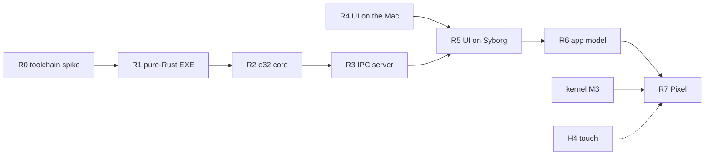

# Rust integration: the `e32` crates and the Rust UI, built in parallel with the kernel

Written 2026-11-06. This expands Track U of the [roadmap](roadmap.md).

The Rust work does **not** wait for the Pixel kernel. It is developed and tested now on QEMU Syborg, running the real
2010 ARM Symbian user side. Once the Pixel kernel boots the user side (roadmap **M3**), the same Symbian executables
move to the phone. Sizes are **GUESSES**.

## Why this works now

- **There is a ready ARM test platform: [`Phorepoc/symbian-2010`](https://github.com/Phorepoc/symbian-2010).**
  - It is the 2010 release, built with GCC 14 and booted in QEMU Syborg
    ([`ghcr.io/phorepoc/qemu-syborg`](https://github.com/Phorepoc/qemu-syborg)) to a text shell.
  - It has a keyboard, mouse, a C: drive, a serial log and framebuffer screenshots (`fb.ppm`), and it runs headless
    in CI.
  - All 13 Symbian packages it needs are already in the NeoSymbian forks, and its `fetch.sh` takes `SOURCES_URL`.
- **It uses the same ABI as Phorepoc's user side:** `-march=armv5te`, ARM and Thumb code, soft-float
  (`toolchain/symcc`).
  - Its emitter turns ELF files into E32Images from the frozen `.def` files, with no `elf2e32` needed.
  - `toolchain/efile_exe/` and `toolchain/dll_rt/` provide the start-up code for programs and DLLs.
- **The same binaries run on the Pixel.** Our AArch64 kernel runs the 32-bit user side at AArch32 EL0, and ARMv5TE
  code runs on ARMv8 cores in AArch32 mode. So one binary works on both platforms: Syborg now, the Pixel after M3.

## Decisions

| Topic | Decision | Why |
|---|---|---|
| Rust target | **`armv5te-none-eabi`** on a pinned nightly (`rust-toolchain.toml`, `-Zbuild-std=core,alloc`), with `panic=abort` | Exact match of the user-side ABI (ARMv5TE, soft-float), so it runs on Syborg and on the Pixel. `armv7a-none-eabi` can come later as a speed option for Pixel-only builds. **Never `eabihf`:** it passes floats differently and breaks calls into Symbian libraries. |
| Test platform before M3 | QEMU Syborg, through NeoSymbian forks of `symbian-2010` and `qemu-syborg` | Real 32-bit ARM Symbian user side, scriptable, runs in CI, no hardware needed |
| CI | GitHub Actions on the public repos, using the public `ghcr.io/phorepoc/*` images. Screenshot and serial log kept as artifacts. | Progress is visible to everyone; no ZimaOS dependency |
| Kernel interface | Rust makes **exec calls directly** (`swi`), with the table generated from `kernelhwsrv/kernel/eka/kernel/execs.txt`. Features that exist only in euser's C++ (leaves, `TRAP`, the active scheduler) go through a thin C shim, and only when unavoidable. | No C++ name mangling; no leave or unwind ever crosses into Rust |
| Entry point | Rust defines `E32Main` (`#[export_name = "_Z7E32Mainv"]`), linked with symbian-2010's `efile_exe` start-up | Behaves like any other Symbian EXE |
| Repos | New: **`NeoSymbian/e32-rs`** (system crates) and **`NeoSymbian/neoui`** (UI server and apps). Forked: `symbian-2010`, `qemu-syborg`. | New work goes in new repos; dependencies are forked |

## Phases

There are two parallel streams:
- **Stream A, the system crates (R0–R3)**;
- **Stream B, the UI developed on the Mac (R4)**.

They meet in **R5**. **R7** waits for kernel M3, and for H4 for touch.

### R0: platform and toolchain spike (stream A)

Steps:
1. Fork `Phorepoc/symbian-2010` and `Phorepoc/qemu-syborg` into NeoSymbian, and fetch with
   `SOURCES_URL=https://github.com/NeoSymbian`.
2. Build the minigui ROM and boot it, on ZimaOS or in Actions.
3. Add the Rust target and compile a `no_std` Rust staticlib.
4. Link the staticlib into a small C++ EXE through symbian-2010's emitter, as a new component next to theirs. The
   C++ calls a Rust function that prints through `RDebug`.

Exit: "hello from Rust" appears in `serial.log`.

**Status: done (2026-11-06).** `NeoSymbian/e32-rs` `crates/rust-hello` (nightly-2026-10-20, `build-std` core) is linked
with `toolchain/rust/neo_glue.cpp` by `emitter/build_rust_exe.py` in `NeoSymbian/symbian-2010` (`3167456`) into
`NEOHELLO.EXE`. Typing `neohello` into ESHELL on Syborg prints `neo: start` / `hello from Rust` /
`neo: rust_hello(6, 7) = 42` and exits cleanly. Findings:
- The object carries the expected attributes: `CPU_arch` v5TE, no VFP argument passing, relocations
  `ABS32`/`CALL`/`PREL31` only.
- The EXE has to go in the ROM (`Z:\sys\bin`). Loaded from C:, the loader rejects symbian-2010's images with
  `KErrCorrupt`, which is worth investigating before apps install to C:.
- The linker warns that the Rust object declares a 4-byte `wchar_t`. That's harmless while no `wchar_t` crosses the
  boundary; Symbian text is `TUint16` anyway.

### R1: an EXE written only in Rust (stream A)

`e32-sys` crate:
- exec-call numbers and the fast/slow encoding, generated from `execs.txt` by a small generator that mirrors
  `genexec.pl`;
- `#[repr(C)]` mirrors of `TDesC8`/`TDesC16`, handles and `TRequestStatus`.

`E32Main` is written in Rust and uses `DebugPrint` and `User::Exit`; the panic handler calls `User::Panic`.

Exit: a Rust-only EXE on the C: drive runs from eshell, prints, and exits with its own exit code. A CI job does this
on every push.

**Status: done (2026-11-06)**, in `e32-rs` `8b903c1` and `symbian-2010` `1161bef`.
- `tools/gen_execs.py` numbers `execs.txt` the way `genexec.pl` does. All 315 numbers match the 2010 `exec_enum.h`.
- `e32-sys` makes `swi #N` calls through `asm!` (`DebugPrint` = 86, `ThreadKill` = 115, `UserThreadExiting` = 246).
- `e32` provides `dprintln!`, `process::exit`/`panic` and `e32::main!`.
- On Syborg:
  - `NEOR1.EXE` prints and exits 42; ESHELL shows `Exit type 0,42,Kill`.
  - `NEOPANIC.EXE`'s `panic!` becomes a Symbian panic; ESHELL shows `Exit type 2,0,RUST`.
  - The shell survives.
- The EXEs run from the ROM, not C: (the `KErrCorrupt` issue from R0 is still open).
- symbian-2010 builds every EXE listed in a manifest (`rust/exes.txt`). Its kernel glue now also logs non-zero exit
  codes, and `boot.sh` takes several commands per boot.

### R2: the `e32` core (stream A)

- **Memory allocator** on a private `RChunk`, so `alloc` works without depending on euser's `RHeap`.
- **Threads and timing:** threads, semaphores, mutexes, `RTimer`, process arguments, waiting on `TRequestStatus`.
- **A minimal async executor** built on request statuses, replacing Symbian's active objects.
- **A file-server client** written in Rust (`RFs`/`RFile` over IPC: connect, open, read, write). It proves that IPC
  and descriptors work.
- **`e32-tests` EXE:** an on-target test runner that reports over serial, with CI parsing the results. Pure logic gets
  ordinary unit tests on the host.

Exit: the tests pass on Syborg.

**Status: done (2026-11-06)**, in `e32-rs` `f1e0431` and `symbian-2010` `c6b0b10`.
- `NEOTEST.EXE` passes all 6 on-target tests on Syborg: alloc (heap grown past 64 KB), timer, async (two joined
  delays take one delay's time), threads (4 threads, a kernel mutex, exit codes), semaphore ping-pong, and fs
  (`C:\neotest.txt` written, read back, sized, reopened).
- Design notes:
  - The heap lives in a private chunk grown with `ChunkAdjust`, using `linked_list_allocator`.
  - Locks use kernel mutexes, because ARMv5TE has no compare-and-swap.
  - Threads start through the EXE start-up's `RunThread`, using the full 64-byte create info.
  - `SessionSendSync` uses an assembly stub that passes the extended arguments in r4–r8.
  - The file server is spoken to directly: `!FileServer`, version 2.0.4011, subsession handle in argument slot 3.
- **C: loading is fixed.** The image writer flagged ELF-style import blocks as PE, so the loader's `ValidateImports`
  returned `KErrCorrupt`; the ROM builder ignores that flag, which is why ROM images worked. `NEOR1C.EXE` now runs
  from C:.

### R3: an IPC server in Rust (stream A)

- An equivalent of `CServer2` built on exec calls: create the server, receive messages, complete them, read and write
  the client's descriptors.
- Interop tests: a Rust server with a Rust client, and a Rust server with a C++ `RSessionBase` client.

Exit: both pass on Syborg.

**Status: done (2026-11-06)**, in `e32-rs` `47d2a2d` and `symbian-2010` `0f6f5d9`.
- `e32::server` is the Rust `CServer2`:
  - `Server::create`, and `receive` as a future (cancelled on drop), so R5 can mix IPC with input and timers in
    one `block_on`;
  - `Message`: read and write the client's 8- and 16-bit descriptors, `complete` (it consumes the message, so a
    stale handle can never complete a newer message), `panic_client`;
  - `serve` over a `Service` trait: connect with a version check, per-session state, disconnect, and bad clients
    panicked as CServer2 does.
- Tested both ways on Syborg:
  - neotest's `ipc_server`: the NeoEcho service on a thread, with a Rust client using two concurrent sessions;
    `neotest: 7 passed, 0 failed`.
  - `NEOCLI.EXE`, plain C++ using only euser (`RProcess::Create` and `Rendezvous`, `RSessionBase`, `TIpcArgs`), starts
    the Rust `NEOSRV.EXE` and runs 9 checks across the process boundary; the server exits `Kill 0` when its last
    session closes.
- ABI notes:
  - `MessageIpcCopy` (169) is an extended exec: `SIpcCopyInfo` goes in r4–r6.
  - The kernel writes 32 bytes of `RMessage2`.
  - `SetSessionPtr` is only allowed on a connect message.
  - Disconnect (−2) accepts only a complete.
  - The client's descriptor length changes only when the message completes.
- `TIpcArgs` now borrows its descriptors. The first on-device run caught a temporary descriptor that died before the
  send; with the borrow, that mistake no longer compiles.
- Shortcuts: there's no `CPolicyServer` security policy (needed before third-party apps, R6), and a server handles
  one message at a time (a `Message` can be kept for a deferred reply).

### R4: the UI on the Mac (stream B, can start on day 1)

- **`neoui-proto`** (`no_std`): the protocol for surfaces, damage rectangles, input events (touch and keys), focus and
  app lifecycle. Tested on the host.
- **`neoui-server`:** the compositor, with damage tracking and CPU blitting, behind a `Platform` trait (display, input,
  clock, IPC).
- **A host backend:** a desktop window where the mouse pointer stands in for touch. It runs at both **1080×2160** (the
  Pixel) and **768×640** (Syborg), which keeps the UI resolution-independent.
- **First screens** in Slint, using its software renderer: launcher, status bar and one demo app.

Exit: the launcher is usable on the Mac, with screenshots in the repo.

**Step 1 done (2026-11-06)** in `NeoSymbian/neoui`:
- `neoui-proto` and `neoui-render` are `no_std` and build for `thumbv7em`.
- Slint 1.18.1 renders `ui/launcher.slint` into a raw XRGB8888 buffer, redrawing only what changed.
- `neoui-host` uses winit + softbuffer.
- Snapshot tests at 1080×2160 and 768×640 check that a tap changes the frame and stays inside the reported damage.

**Step 2 done (2026-11-06)**: first screens, in `neoui` `90871bb` and `76c9384`.
- Design language "Belle, modernized". `ui/theme.slint` tokens are measured from the Symbian^3 open layout data and
  from a real N8 running Belle Refresh; `design/DESIGN.md` gives the source of each value.
- An original icon set from `tools/make_icons.py`: 13 app tiles, 71 glyphs and the clock digits.
- `ui/shell.slint` covers the home screen, the app menu, a notification shade, the Options menu and 12 app screens
  with sub-views (phone, messages, contacts, browser, camera, photos, music, calendar, clock, files, settings,
  terminal), all with invented sample data.
- `neoui-host --screen app[/view]` opens any screen directly.
- Every screen has a snapshot test.
- Still to do in R4: `neoui-server`, so that apps run as separate clients rather than as views inside one Slint
  component.

**Open decision: the UI toolkit's licence.** (2026-11-06: Slint under GPL-3.0 for development; ROM images are not
published; decide before a release.)
- Slint is available under GPL-3.0, a royalty-free licence, or a commercial licence.
- The royalty-free licence excludes embedded systems, which an OS launcher or UI server may count as.
- Under GPL-3.0, an image that combines it with EPL-1.0 Symbian code may not be distributable, because the two
  licences are incompatible.
- Settle this before R5 ships Slint in a ROM. The alternatives are Slint's commercial licence, or a permissive
  renderer (our own, or `embedded-graphics`) behind the same `neoui-render` API.

### R5: the UI on Syborg (streams A + B)

- A Symbian `Platform` backend:
  - **display:** memory address, mode and stride from HAL (`EDisplayMemoryAddress`, …);
  - **input:** the kernel's event hook (`CaptureEventHook` / `RequestEvent` exec calls), the same path the window
    server uses.
- A ROM variant **without the window server:** the system starter launches the Rust UI server instead of wserv.

Exit: the Rust launcher appears on the Syborg screen (`fb.ppm` in CI), and clicks sent through QEMU's `mouse_button`
change it.

**Status: done (2026-11-06)**, in `neoui` `6861aff` (`symbian/`), `e32-rs` `c82dfd2`/`5dae8bd`, and `symbian-2010`
`19f30b8`.
- The launcher runs as **`SYSSTART.EXE`**. estart starts it in place of the window server, which was simpler than
  writing a new starter config.
- It reads the frame buffer from the HAL (`EDisplayHalCurrentModeInfo`: 768×640, 32 bpp, `0x00RRGGBB`, a global
  user-writable mapping).
- It registers as the window server (`WsRegisterThread`, `CaptureEventHook`) and takes raw pointer and key events
  from the kernel.
- It renders into a RAM frame and copies the damaged rectangles to video RAM.
- On Syborg the first frame takes about 80 ms. A QEMU-monitor tap on Phone opens the Phone screen. CI
  (`neoui/.github/workflows/syborg.yml`) checks the log and the screen.
- Slint on ARMv5TE: it builds as-is (`portable-atomic` needs no compare-and-swap) once `e32` provides two things:
  - a `critical-section` implementation, which is a kernel mutex;
  - `__aeabi_unwind_cpp_pr0`, because Slint's EHABI tables would otherwise drag in libgcc's C++ unwinder.
- Quirks:
  - The Syborg pointer driver scales x by width/0x6000, so x arrives 4/3 too large; the backend corrects it.
  - The hook exec calls return `void`.
  - The pointer driver draws its own cursor into video RAM, leaving small artefacts.
- Licence: Slint under GPL-3.0 for now, so `neoui/symbian` is GPL-3.0 and ROM images are not published. Decide
  before any release.
- Not yet: app processes and surfaces (R6), a keymap beyond ASCII, a security policy.

### R6: the app model (streams A + B)

- Apps are separate processes. Their surfaces live in global shared chunks, and they talk to the server over R3's IPC.
- The launcher starts apps. A terminal app runs the old Symbian text programs (split out as R6b).

Exit: launcher → demo app → back to the launcher, on Syborg.

**Status: done (2026-11-06)**, in `neoui` `5633ee2`, `e32-rs` `4659c03`, and `symbian-2010` `7ba685e`.
- **The UI server (`SYSSTART.EXE`) is now also the `NeoUi` IPC server.** When the shell navigates to `clock`, it
  starts `NEOCLOCK.EXE` through the loader: one `ELoadProcess` message to `!Loader` with a 32-byte `TLdrInfo`, then
  `ProcessResume`.
- **The app's lifecycle:**
  - It connects and asks for `GEOMETRY` (the shell's body, 768×487, and the design unit).
  - For `SURFACE`, the server creates an unnamed **global** chunk and answers with `MessageCompleteWithHandle`. The
    chunk sits at the same address in both processes, and a local chunk could not be shared.
  - The app renders its own Slint UI (the design's theme and digits) into the surface and reports `DAMAGE`. It
    keeps one async `NEXT_EVENT` outstanding through the new `Session::send`.
  - The server composes the surface into the body, between the live status bar and toolbar, and routes touches
    there to the app in body coordinates.
  - On Back the server sends `Quit`. The app exits 0, and the server reaps it with `ProcessExitType`.
- **The Clock** shows Symbian's real time (`TimeNow` and a civil-date conversion) and ticks every second.
- **CI** (`neoui` `syborg.yml`) runs Apps menu → scroll → Clock → tap → Back through the QEMU monitor
  (`boot.sh` `MONITOR` plus `MON_GAP`, because drags need about 0.3 s between steps).
- **Found:** the design prototype's home pages can't be tapped, because a swipe `TouchArea` declared after the
  pages covers them. CI therefore opens Clock from the Apps menu. Reported to the design stream.
- **Shortcuts:**
  - one foreground app, killed on leaving;
  - a fixed app table (`clock` → `neoclock`);
  - no access policy on `NeoUi`;
  - the time zone is whatever the kernel's UTC offset says.

### R6b: the terminal

- ESHELL and the 2010 text programs in a terminal app. Use the stock kernelhwsrv `econs.dll` (it is a client of
  `!E32WindowServer`, about 20 opcodes) built in place of `econswserv` in the ROM, plus a Rust console server: a text
  grid, the cursor, a key queue and a held `Read`.
- The terminal app starts ESHELL per window, and the UI server routes keys to it.

**Status: done (2026-11-06)**, in `neoui` `f25bc67` and `symbian-2010` `6923dc6`.
- `NEOTERM.EXE` (`neoui/symbian/apps/term`) is an R6 app and the console server `!E32WindowServer`:
  - one window per client session, newest on top;
  - a held `Read` answered with a 24-byte `SConsoleKey`;
  - the `TConsoleWinOpcodes`; `Size` includes the stock 2-character frame.
- The UI ROM (one whose Rust manifest has `SYSSTART.EXE`) ships the stock `econs.dll` as `ECONS.DLL`. Other ROMs
  keep `econswserv`.
- The grid model (`neoui/crates/neoui-term`, host-tested) follows the stock console's rules: newline mode, wrap,
  destructive backspace, tab stops of 4, scrolling.
- On Syborg (539×1079, a 46×29 grid): ESHELL's banner and `C:\>`, `dir`, and `neotest` started by ESHELL
  (`7 passed`). CI types them through the QEMU monitor.
- Found: closing the console server before completing the held `Read`s panics the app (KERN-EXEC 44). They are now
  completed first.
- Not yet: a soft keyboard (needed on the phone), colours and attributes, scrollback.

**Phone handoff (for the kernel session's ROM, which now boots neoui by default):**
- Rebuild `neoui/symbian` from `f25bc67` or later: `cd symbian && cargo arm --workspace`. Since `d4dfdad` neoui
  takes touch as plain screen pixels; the old ¾-x Syborg correction is gone, because the Syborg driver itself was
  fixed.
- For the apps, add the lines from `neoui/symbian/exes.txt`: `NEOCLOCK.EXE 0xE0002002 libneoclock.a` and
  `NEOTERM.EXE 0xE0002003 libneoterm.a`.
- For the Terminal, put kernelhwsrv's stock `econs.dll` in the ROM as `ECONS.DLL` when SYSSTART is present (see
  symbian-2010 `emitter/components.py` `econs` and `kernel/rom_args.py`).
- To check on the phone:
  - the R6 shared surface under the **flexible** memory model (each side asks `ChunkBase`, no shared address assumed);
  - frame time at 1080×1800.
- Typing needs a soft keyboard; the hardware keys only reach the extra-keys bar's codes. (Done in R6c, below.)

### R6c: a system keyboard and a live clock

**Status: done (2026-11-06)**, in `neoui` `0efa85a`.
- The UI server draws a system on-screen keyboard (`neoui/ui/components/keyboard.slint`: letters and symbols, one-shot
  shift) over the bottom of the foreground app, above the toolbar.
- An app asks with `KEYBOARD` (op 5: show 1/0). The request completes with the height it covers. Its keys reach the
  app as `InputEvent::Key`, the same path as hardware keys, so apps need no new input code.
- The Terminal opens it and fits its grid above it: 46×19 at 539×1079, down from 46×29.
- The status-bar time follows Symbian's clock (`TimeNow`). The server logs `neoui: clock HH:MM` once a minute.
- Checked:
  - **host test** (`crates/neoui-render/tests/keyboard.rs`): taps keys and checks what they type;
  - **Syborg CI**: types `dir` into ESHELL by touch only (`taps.sh kb_type`), and the listing appears.
- Not yet:
  - key repeat, long-press, Ctrl;
  - layouts other than US;
  - a hide toggle with grid reflow in the Terminal.

**Phone handoff:** rebuild `neoui/symbian` from `0efa85a` or later. The Pixel can then type into the Terminal by
touch. Nothing else changes in the ROM.

### R7: the Pixel (needs kernel M3; touch needs H4)

- The same binaries go into the Pixel ROM. The backend finds the Pixel's display (the 1080×2160 splash framebuffer)
  through HAL.
- Input: volume and power keys first, touch once the Synaptics driver (H4) delivers raw events.
- Later, for speed: an `armv7a-none-eabi` build, then the GPU (roadmap U4).

Exit: the Rust launcher on the phone, driven by touch.

## How this maps to the roadmap

| These phases | Roadmap stage |
|---|---|
| R0–R3 | U1 |
| R4–R6 | groundwork for U2 and U3 |
| R7 | U2 on the Pixel |

## Risks

- **QEMU 0.9.1 has no CPU acceleration.** Syborg proves that things work, not how fast they are. Slint will be slow
  there.
- **`armv5te-none-eabi` is a tier 3 Rust target.** It needs nightly plus build-std, so pin the nightly version.
- **Only one process can capture the kernel's event hook.** The ROM must not start wserv when the Rust server runs.
- **Syborg's exact CPU model is unverified.** ARMv5TE code runs on any model it could be.
