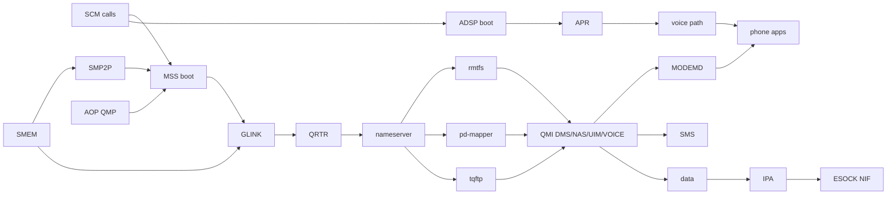

<!-- SPDX-License-Identifier: Apache-2.0 -->
# Modem: cellular calls, SMS and data on the Pixel 3a XL

Part of [Hardware](README.md) · Status: active · Updated: 2026-11-21 · Neighbours: [audio](audio.md), [wifi](wifi.md), [gnss](gnss.md), [bluetooth](bluetooth.md), [battery](battery.md)

Written 2026-11-08 as the end-to-end runbook for roadmap Track P: from a silent modem to a phone that places and takes
calls, sends SMS and uses mobile data. Calls, SMS and modem recovery work (C0–C9); mobile data, VoLTE and persistence
(C10–C12) are open. The bring-up log of C0–C9 is in [history/modem-bringup.md](history/modem-bringup.md); each stage
below keeps a short summary. The code is in the kernel (`sdm670_assp`) and in [neohw](https://github.com/NeoSymbian/neohw)
(HWHUB, MODEMD, AUDIOD: [the processes](README.md#neohw-the-processes-and-their-ipc)).

- Facts marked **DTB** come from the mainline bonito device tree (the ztOS boot.img, `~/WS/ztOS/ztos-work/google-bonito/sdc/boot.img` on the owner's Mac).
  Dump it with `dtc -I dtb -O dts` after the `d00dfeed` magic.
- **Linux** facts are taken from the mainline drivers named next to them. They describe protocol behaviour and are
  used as reference ([Sources and licences](#sources-and-licences)).
- **unverified** means not checked yet. Stage C1 is meant to check most of them.

## Decisions

| Decision | Made by | Choice |
|---|---|---|
| Networks | user | The SIM's network has 3G and 4G/VoLTE. |
| First milestone | user | A full voice call: dial and answer, two-way audio through the earpiece and the mic. |
| Calls on 4G | **my call** | The modem registers on LTE and uses **CSFB** for calls: it drops to 3G for the call by itself, with no IMS needed. VoLTE is a separate stretch stage (C11). |
| Symbian stack | **my call** (user: "you decide") | A Rust `modemsrv` server plus neoui apps, **no ETel at first**. The 2010 Phone app needs the classic Avkon UI, which neoui replaced. A thin ETel TSY over `modemsrv` comes in C12, only if old apps need it. |
| Language split | roadmap | Transport (SCM, SMEM, SMP2P, GLINK, remote-processor boot, IPA rings) is kernel C++. Protocols (QRTR, QMI, rmtfs, pd-mapper, tqftp, APR, call logic) are user-side Rust. |
| Sources | user: "any option, prefer our own" | Our own code first. The BSD-3 linux-msm tools can be ported closely, with attribution. GPL Linux drivers are reference only. If a piece stalls, porting the GPL driver directly is allowed: that file then carries a GPL-2.0 header and is listed in [Sources](#sources-and-licences). |
| Firmware | **my call** | Qualcomm's signed firmware is read at runtime from the phone's own `modem_a` and `dsp_a` partitions. It never goes into a repo or a ROM. |

## Safety rules

- **Gate G4** (new; the other gates are in `filesystem.md`): any write to `modemst1`, `modemst2`, `fsg`, `fsc`,
  `modemcal`, `persist` or `modem_a/b` needs the owner's OK at the time. Until G4, rmtfs keeps the modem's EFS writes in
  RAM.
- Back up the radio partitions (C0) before the first modem boot of any OS.
- Never put the IMEI, ICCID, IMSI, phone numbers or the DTB in a repo or a committed log. Monitor commands print
  them masked (`35xxxxxxxxxxx12`).
- Don't rely on this phone for emergency calls.

## Hardware facts (DTB)

| Block | Facts |
|---|---|
| **MSS (modem)** | `qcom,sdm670-mss-pil`. QDSP6 registers at `0x4080000`, RMB at `0x4180000`. Watchdog = SPI 266. fatal / ready / handover / stop-ack / shutdown-ack = smp2p-mpss inbound bits 0 / 1 / 2 / 3 / 7. The stop request is outbound bit 0. |
| MSS clocks | GCC: iface, bus, mem, gpll0_mss, snoc_axi, mnoc_axi, prng; plus RPMh xo |
| MSS power and reset | Power domains rpmhpd cx, mx, mss. Resets: AOSS `0xc2a0000` `mss_restart`, PDC `0xb2e0000` reset 9. Halt registers in TCSR `0x1f60000` at +0x3000 (q6), +0x5000 (modem), +0x4000 (nc). Needs an AOP QMP message (`qcom,qmp`) |
| MSS memory | mba `0x95600000` + 2 MB, mpss `0x8b000000` + 0x9800000 (152 MB) |
| Firmware | `modem_a` (FAT16, 4096-byte sectors) holds only the modem: `IMAGE/MBA.MBN`, `MODEM.MDT` + `MODEM.B00`–`B30`, `MODEMR.JSN` (root PD, QMI instance 180), `QDSP6M.QDB`. Build MPSS.AT.4.0.2.c4.1-00120, radio `g670-00145-220106-B-8048689` (2022-01-06). **There is no `dsp_a`**: the ADSP firmware, the `mcfg` carrier profiles and `ipa_fws` sit on `vendor_a` (`/vendor/firmware`, **unverified**), taken from Google's factory image of that radio build. Linux names: `qcom/sdm670/sargo/{mba,modem,adsp,ipa_fws}.mbn` |
| **SMEM** | `0x86000000` + 2 MB, hwlock = TCSR mutex 3 |
| **APCS IPC** | `0x17990000`; doorbell register +0xc. Bits: AOP QMP 0, modem GLINK 12, modem SMP2P 14, ADSP GLINK 24, ADSP SMP2P 26 |
| GLINK edges | modem: SPI 449, remote pid 1. lpass (ADSP): SPI 170, remote pid 2 |
| SMP2P | mpss: SMEM items 435 (**in**, the modem's) / 428 (**out**, ours), SPI 451. lpass: in 443 / out 429, SPI 172. Our out entries "master-kernel" (bit 0 = stop), "ipa"; the modem's in entries "smp2p", "slave-kernel" (fatal 0, ready 1, handover 2, stop-ack 3, shutdown-ack 7) |
| **AOP QMP** | `0xc300000`, SPI 389, mbox bit 0 |
| **rmtfs** | `0xfc201000` + 2 MB (guard pages on both sides), client-id 1, VMID 15 (MSS_MSA) |
| **ADSP** | `qcom,sdm670-adsp-pas` at `0x62400000`, memory `0x95800000` + 0x2200000. Watchdog SPI 162; fatal/ready/handover/stop-ack = smp2p-lpass bits 0–3. APR on GLINK channel `apr_audio_svc`, protection domain `avs/audio` (`msm/adsp/audio_pd`). ACDB name `Global_cal.acdb` |
| **Audio** (C1, from the pmOS UCM + the live mixer) | **Earpiece and loudspeaker** = two Cirrus Logic **CS35L36** amps ("Top", "Bottom") on I2C bus 2 at 0x40/0x41, fed by the ADSP's `SEC_TDM_RX_0`. **Built-in mic** = DMIC through `PRIMARY_TDM_TX_0` ("Sto1/Sto2 ADC MIXL DMIC"). The PM660L analog codec (`qcom,pm660l-wcd-analog-codec`, SPMI 0xf000) + the digital codec (`0x62ec0000`, mclk 9.6 MHz) serve only the 3.5 mm jack (`LPI_MI2S_RX_0` / `LPI_MI2S_TX_3`). Voice = ADSP `VoiceMMode1` (ALSA card 0 device 4), RX topology 268504967, TX 268500988 |
| **IPA** | `0x1e40000` (+gsi `0x1e04000`), IRQs SPI 311 / 432 and smp2p ipa bits. SMMU stream IDs 0x720/0x722. Carve-outs ipa-fw `0x97a00000`, ipa-gsi `0x97a10000` |
| Other carve-outs | hyp `0x85700000`, tz `0x86200000`, cdsp `0x94e00000`, wlan-msa `0x94d00000`, spss `0x97b00000`, qseecom `0x9e400000` |

## The bring-up chain

## Stages

<!-- stages -->
| Stage | What | State | Updated | Next / evidence |
|---|---|---|---|---|
| C0 | Recon and backups | done | 2026-11-08 | radio partitions hashed, carve-outs safe (kernel 1253e70) |
| C1 | Linux reference run | done | 2026-11-08 | GO: LTE and a two-way call under mainline Linux |
| C2 | Kernel transport | done | 2026-11-08 | SCM, SMEM, SMP2P, QMP, GLINK (kernel a5283de) |
| C3 | Modem boot | done | 2026-11-08 | MSS boots from modem_a and talks QRTR (kernel a5283de) |
| C4 | Modem services | done | 2026-11-08 | rmtfs, locator, TFTP; the modem stays up |
| C5 | QMI, NeoModem, dialer (no audio) | done | 2026-11-09 | calls out and in, silent |
| C5b | IPA, the first half of C10 | done | 2026-11-09 | the modem stays on LTE (kernel d003355) |
| C6 | Call audio | done | 2026-11-09 | two-way audio on earpiece and loudspeaker (kernel b12d1ba) |
| C7 | Complete calls | done | 2026-11-21 | merged 2026-11-12; recovery accepted (kernel#38, neohw#14); 24-hour run not done |
| C8 | Call log and contacts | done | 2026-11-14 | NEOPHONE in NeoSymbian/phone, installed on slot a |
| C9 | SMS | done | 2026-11-16 | sent, delivered and received; installed on slot a |
| C10 | Mobile data | open | — | IPA QMI handshake, modem data endpoints, IPA teardown on a modem stop |
| C11 | VoLTE (stretch) | open | — | go/no-go after C10 |
| C12 | Persistence, power, compatibility | open | — | G4 EFS writes need the owner's OK; suspend (H3) |
<!-- /stages -->

Exits: C10 an HTTP fetch over LTE (and 3G); C11 a VoLTE call or a recorded no-go; C12 the EFS persists (G4) and the
phone idles overnight and still rings. The first plan's exit table and size guesses are in the
[log](history/modem-bringup.md#the-first-plan).

### C0: recon and backups

Done 2026-11-08 (kernel `1253e70` + `5c65051`): the radio partitions are backed up and hashed in `private/radio-backup/`, the
firmware is listed and the carve-outs are safe. `blk dump` and `phone.py dump` read the eMMC at 2.0 MB/s, SHA-256
checked on both ends. Log: [history/modem-bringup.md](history/modem-bringup.md#c0-recon-and-backups).

### C1: Linux reference run (throwaway)

GO 2026-11-08: a postmarketOS mainline Linux RAM boot registered on LTE (UCOM) and took a call with two-way audio.
Its captures (`private/c1/`) are the reference for the later stages; the recipe is in
[neohw/c1-linux](https://github.com/NeoSymbian/neohw/tree/main/c1-linux). Log: [history/modem-bringup.md](history/modem-bringup.md#c1-linux-reference-run-throwaway).

### C2: kernel transport (done 2026-11-08, kernel `a5283de`)

Polled SCM, SMEM, SMP2P, AOP QMP and GLINK in `kernel/baseport/arm64/sdm670_assp/`, with monitor commands. Never
read another host pair's SMEM partition: the bus stalls and the watchdog resets the phone. Log: [history/modem-bringup.md](history/modem-bringup.md#c2-kernel-transport-done-2026-11-08-kernel-a5283de).

### C3: modem boot (done 2026-11-08, kernel `a5283de`)

The kernel reads the firmware from `modem_a` itself (`qcom_fat16.cpp`) and boots the MSS (`qcom_mss.cpp`, the Linux
`sdm845_mss` flow: 158 MB in 5.9 s); the modem talks QRTR. Log: [history/modem-bringup.md](history/modem-bringup.md#c3-modem-boot-done-2026-11-08-kernel-a5283de).

### C4: modem services (Rust, user side) (done 2026-11-08)

QRTR, rmtfs (writes kept in RAM until G4), the locator and TFTP on the user side; the SMEM board record (item 134)
keeps the modem's RF task alive. Then in MODEMD; since neohw S3 (2026-11-18) in HWHUB. Log: [history/modem-bringup.md](history/modem-bringup.md#c4-modem-services-rust-user-side-done-2026-11-08).

### C5: QMI + modemsrv + dialer (no audio) (done 2026-11-09)

QMI DMS, NAS, UIM and VOICE clients in MODEMD, the NeoModem IPC server (`modem-ipc`) started by SYSSTART, and the
shell's Phone screen: calls out and in, still silent. The QMI message facts are in the log: [history/modem-bringup.md](history/modem-bringup.md#c5-qmi--modemsrv--dialer-no-audio-done-2026-11-09).

### C5b: IPA (the first half of C10, moved earlier) (done 2026-11-09, kernel `d003355`)

IPA runs (its GSI firmware through PAS 15, an identity SMMU context, the command and LAN_RX channels), so the modem
stays on LTE. The IPA QMI handshake and the modem's data endpoints are left for [C10](#c10-mobile-data).
Log: [history/modem-bringup.md](history/modem-bringup.md#c5b-ipa-the-first-half-of-c10-moved-earlier-done-2026-11-09-kernel-d003355).

### Network time (NITZ) (done 2026-11-13)

MODEMD reads the NAS network time and passes it in the NeoModem status (`modem_ipc::Nitz`); neoui sets the clock
from it. Log: [history/modem-bringup.md](history/modem-bringup.md#network-time-nitz-done-2026-11-13).

### C6: call audio (= roadmap H5 for voice)

Done 2026-11-09 (kernel `b12d1ba`, neohw `3f4af12`, neoui `2d55d01`): the ADSP boots before the modem, APR runs in
Rust, and a kernel board driver runs the CS35L36 amps and the RT5514 mic; two-way call audio on the earpiece and the
loudspeaker. Since neohw S4 (2026-11-18) AUDIOD owns APR ([audio.md](audio.md)). No ACDB calibration. Log: [history/modem-bringup.md](history/modem-bringup.md#c6-call-audio--roadmap-h5-for-voice).

### C7: complete calls

Merged 2026-11-12: modem-ipc 2 (up to eight calls, SIM PIN, airplane mode), the ringtone and haptics, and modem
recovery. The recovery was redone the Linux way and accepted on the phone on 2026-11-21
([below](#modem-restart-and-the-adsp-fixed-2026-11-21-kernel38-neohw14)). Not accepted yet: the 24-hour use run and
call waiting/swap/merge with real call legs; the wired headset was deferred. Log: [history/modem-bringup.md](history/modem-bringup.md#c7-complete-calls).

### C8: call log and contacts

Done 2026-11-14: the call log, caller ID, call waiting, contacts and the blocklist (modem-ipc 2.1–2.2, the
`phone-rules` crate). Phone and Contacts moved into [NeoSymbian/phone](https://github.com/NeoSymbian/phone)
([phone.md](../apps/phone.md)); facts from the 2010 sources in [symbian-phone-sources.md](../reference/symbian-phone-sources.md). Log: [history/modem-bringup.md](history/modem-bringup.md#c8-call-log-and-contacts).

### C9: SMS

Done 2026-11-16: SMS over QMI WMS in MODEMD (the `sms` crate, `sms.db`, modem-ipc 2.3–2.6) and Messages in the phone
apps; sent, delivered and received on the phone, installed on slot a the same day. Not done: MMS (needs C10), cell
broadcast, SMS over IMS. Log: [history/modem-bringup.md](history/modem-bringup.md#c9-sms).

### C10: mobile data

- **Control:** QMI WDS (start network interface, APN from settings), WDA (QMAP data format), and the IPA QMI
  handshake with the modem (Linux `ipa_qmi.c`).
- **Data path, kernel C++:**
  - the IPA hardware: load `ipa_fws.mbn` through PAS, GSI channels and rings, and the IPA SMMU context (stream IDs
    0x720/0x722);
  - rmnet/QMAP framing.
  - Reference: Linux `drivers/net/ipa`.
  - **Risk:** the first SMMU work in the port.
  - C5b brought up the IPA firmware, the SMMU context and the command and LAN_RX channels. Left: the modem's data
    endpoints (ch3/ch6), the rest of the IPA QMI handshake (half done at C5b) and Linux's IPA teardown
    on a modem stop ([below](#modem-restart-and-the-adsp-fixed-2026-11-21-kernel38-neohw14)).
- **Symbian side:** an ESOCK/TCPIP6 packet interface (NIF) over the rmnet device. It needs `commsfw`,
  `networkingsrv` (ESOCK/TCPIP6) re-forked from `retired-repos.md`. **Decided 2026-11-12 (owner):** ESOCK/TCPIP6,
  shared with Wi-Fi ([wifi.md](wifi.md)).
- **Fallback:** a small Rust IP stack (smoltcp) behind our own socket API, if the 2010 stack costs too much.
- **Wi-Fi went smoltcp first** (owner, 2026-11-12; [wifi.md](wifi.md) W5): NEONET.EXE and the NeoNet API. C10 picks
  its stack when it starts: an rmnet device under NEONET is the short path.

Exit: ping and an HTTP fetch over LTE, and over 3G with LTE disabled.

### C11: VoLTE (stretch, go/no-go)

- **Question:** can the modem's internal IMS register when the carrier's MCFG profile is selected (QMI PDC), the IMS
  settings are written (QMI IMSS/IMSA), and an IMS APN data session is up (WDS)?
- **Test** on the C1 Linux setup first: how far postmarketOS sdm845-family ports have got is the reference.
- **Yes:** calls go through the same VOICE service and C6 audio path.
- **No:** record it here. Calls stay on CSFB/3G and stop working when the network turns 3G off.

### C12: persistence, power, compatibility

- **G4 (owner's OK):**
  - rmtfs writes the EFS back the way Android does: alternate between `modemst1` and `modemst2`, sync on the modem's
    request;
  - `fsg` stays read-only;
  - only after a verified C0 backup.
  - Until G4 the modem relearns its network caches every boot. Nothing else breaks.
- **Power** (needs roadmap H3 suspend):
  - drop our RPMh votes when idle;
  - the AP suspends with the modem registered;
  - SMP2P/GLINK interrupts wake it for calls and SMS.
  - Exit: idle overnight with a SIM, and an incoming call still rings.
- **ETel (optional):** if old Symbian apps need telephony, a thin C++ TSY over MODEMD after re-forking
  `cellularsrv` (ask first).
- **Out of scope:** eSIM, MMS, Bluetooth call audio (comes with P4 Bluetooth), emergency-call guarantees.

## Code layout

| Where | What |
|---|---|
| `kernel/baseport/arm64/sdm670_assp/` | `qcom_scm`, `qcom_smem`, `qcom_ipc.h`, `qcom_smp2p`, `qcom_qmp`, `qcom_glink`, `qcom_mss`, `qcom_pas`, `qcom_adsp`, `qcom_ipa`, `qcom_smmu`, `qcom_fat16` (reads `modem_a`), `qcom_telhal` (the HAL functions, incl. the read-only partition op; no LDDs), `qcom_telmon` (monitor commands) |
| `kernel/.../bonito_variant/specific/` | `pixel_bonito.cpp` (MMU entries for SMEM, rmtfs, QMP, APCS, codec; the RAM bank's carve-out check), `a64_audio.cpp`, `a64_haptics.cpp` |
| [`neohw`](https://github.com/NeoSymbian/neohw) (Rust) | crates `qrtr`, `hub`, `modem`, `apr`, `modem-ipc`, `phone-rules`, `sms`, `ext4ro`; EXEs HWHUB (QRTR, rmtfs, TFTP, locator, SSCTL, IPA QMI, boot and recovery), MODEMD (cellular QMI, NeoModem), AUDIOD (APR) |
| [`phone`](https://github.com/NeoSymbian/phone) | Phone, Contacts and Messages ([phone.md](../apps/phone.md)) |
| `neoui` | the status bar, the SIM prompt, the shade's call and message entries |

The G4 write path for `modemst1/2` (C12) is not built: rmtfs keeps the modem's writes in RAM.

## Testing

- **Rust protocol crates:** `cargo test` on the Mac, with the C1 captures as vectors (QMI, QRTR, APR, rmtfs
  requests).
- **Kernel:** each stage builds for QEMU too (`neo kernel qemu`, `neo qemu 60`), so nothing regresses. The hardware
  parts are tested on the phone:
  `AUTOFASTBOOT=600 DTB=../private/bonito.dtb neo kernel bonito`, `phone.py run IMG --stay`, then `phone.py cmd …`.
- **Calls need the owner:** the call and SMS exit tests need someone at the other phone.

## Sources and licences

| Source | Licence | Use |
|---|---|---|
| linux-msm `qrtr`, `rmtfs`, `pd-mapper`, `tqftpserv` | BSD-3-Clause | May be ported closely; keep the copyright line in the ported file |
| libqmi `data/qmi-service-*.json` | LGPL-2.1 (data) | Message IDs and TLV layouts, as facts |
| Linux `qcom_scm`, `qcom_q6v5_mss`, `qcom_q6v5_pas`, `qcom_glink_*`, `qcom_smp2p`, `smem`, `qcom_aoss`, `apr`, `q6afe`, `q6asm`, `msm8916-wcd-*`, `drivers/net/ipa` | GPL-2.0 | Reference. A direct port is allowed if a stage stalls; that file is then GPL-2.0 and listed here |
| pmOS/msm8916-mainline `q6voice` | GPL-2.0 | Reference for C6 |
| Android `mixer_paths*.xml` (phone's vendor partition) | proprietary | Register values as facts, read from the phone; never copied into a repo |
| Qualcomm firmware (`modem_a`, `dsp_a`) | proprietary | Loaded from the phone at runtime only |

Direct GPL ports so far: none.

## Modem restart and the ADSP (fixed 2026-11-21: kernel#38, neohw#14)

The modem now restarts the way Linux does it, and Wi-Fi, calls and SMS come back by themselves.

**What was wrong** (3 RAM boots × 2 forced faults, `TEL_DIAGNOSTICS=1`, image pt8, the same every time):
- every stop forced the bus halt ("AXI port 01f65000 failed to halt"), and the next boot failed at step 7
  ("SFR Init: wdog or kernel error");
- a new recovery started right after a successful one (no reason logged); after 3 attempts HWHUB gave up for good;
- the ADSP was never told about the modem going down, and an ADSP check restarted the modem in a loop;
- Wi-Fi never came back (WIFID re-armed its "deaf" flag from an old join failure);
- once the restart itself worked, the modem asserted 1.5 s after IPA's `INIT_DRIVER` every time:
  `ipa_hwp_init ... didnt rx any ind frm HWP`.

**The sequence now** (Linux `qcom_q6v5_mss.c`, `qcom_q6v5.c`, `qcom_sysmon.c`, `qcom_glink_ssr.c`, `ipa_qmi.c`):
1. **One owner.** HWHUB alone restarts the modem and logs each request's reason ("modem FATAL", "MODEMD watchdog",
   "user retry", …). For 30 s after a restart only a crash restarts it again. An ADSP fault marks the ADSP failed
   (audio unavailable) and keeps the modem up. After 3 failed attempts it tries again every 5 minutes.
2. **A running modem is asked first:** SSCTL `SHUTDOWN_REQ` (0x21); HWHUB waits for the ready indication, the
   shutdown-ack bit (7) or FATAL, at most 10 s.
3. **The ADSP is told:** SSCTL `SUBSYS_EVENT_REQ` {"modem", before shutdown / after shutdown / before power-up}, only
   while it runs, never queued.
4. **The kernel stops it gracefully:** unless it crashed or acknowledged the shutdown, our SMP2P `master-kernel` bit 0
   and up to 5 s for stop-ack (bit 3), then the AXI halt and reset; after the halt the ADSP gets GLINK-SSR
   `do_cleanup("mpss")` over its `glink_ssr` channel; the SMEM 421 crash reason is cleared.
5. **IPA after a restart:** the modem's SMP2P clock query is answered again (its "ipa" bit is 1 in both lives, which
   the stale-value filter hid), and `INIT_DRIVER` says `skip_uc_load = 1`: IPA kept running, its microcontroller is
   loaded (Linux keeps `uc_ready` across a restart). That was the last assert.
6. **Wi-Fi:** a reset clears WIFID's stored failure, no joins while the firmware is down, `WlanStart` is retried for
   30 s; the modem fetches `wlanmdsp.mbn` again and WLFW reaches mission mode.

**Result** (images pt12 and the owner's demo, 4 boots, 8 forced faults): one recovery per fault, stop-ack in
118-299 ms, the stop done in ~450 ms, the modem running ~6 s after it, registered ~9 s after the fault, the Wi-Fi
firmware ready ~22.5 s and Wi-Fi reconnected (same IP) ~25 s after it; the ADSP never failed. The owner then checked
a call, an SMS and Wi-Fi internet after a restart.

**Open:** one AXI port still logs "failed to halt" after a clean stop-ack (the reset handles it); the ADSP's own
restart (its PAS shutdown hung, 2026-11-12) is still avoided; Linux's full IPA teardown on a modem stop
(`ipa_modem_crashed`: pause and reset the modem's endpoints and tables, zero its SRAM) isn't ported: not needed
without mobile-data endpoints, needed with C10.
