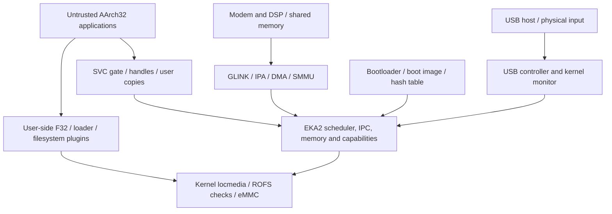

<!-- SPDX-License-Identifier: Apache-2.0 -->
# Kernel modernization assessment

Research snapshot: 2026-11-09. This assessment, the [issue register](kernel-issues.md), and the
[modernization roadmap](kernel-modernization.md) describe the work required for a supported system.
The existing [product roadmap](roadmap.md) continues to track hardware and application features.

## Assessment

EKA2 already provides useful foundations: process isolation, capabilities, typed object handles, checked IPC,
fault-aware descriptor access, SMP scheduling, and a filesystem recovery design. These should be retained and
tested. Age alone does not establish a vulnerability or justify a rewrite.

The reviewed configuration does not yet have evidence sufficient for a production claim. Specific inherited
problems were found in entropy-buffer synchronization/allocation and filesystem recovery error propagation.
Bring-up choices add separate risks: permissive executable capabilities, an unauthenticated privileged USB
monitor, automatic formatting of corrupt persistent volumes, broad DMA mappings, and an incomplete authenticated
boot/update story. Timer accounting and the test runner also have concrete correctness gaps.

This is a first bounded source audit, not a claim to have found every defect. Every finding and every section of
the existing known-issues document is mapped to a stable issue ID. Unreviewed areas are explicit work, not an
assumption of safety. No kernel fix, deployment, installed-phone verification, or full-kernel test pass is
delivered by this documentation change.

## Reproducible baseline

This workspace is a collection of repositories; its root is not a Git repository.

| Repository | Reviewed commit | Context |
|---|---|---|
| NeoSymbian/kernel | 792d36ef1a9169b3fc9084fcc494b209501a7487 | main; source evidence below is pinned here |
| NeoSymbian/docs | 6a6236c41d46481948b8080a362abb4b9f0e10bb | main; starting documentation |
| NeoSymbian/build | 82be8e7a3a006bdf21325e374fa8b9b8299a12f0 | legacy-gui; inspected build/CI, not asserted to be the release branch |

At capture, kernel had nine modified tracked files and five untracked files, including USB/telephony work and
qcom_prng.cpp. Build had a modified neo. These belong to concurrent work and were neither changed nor counted as
fixes. In particular, a new private PRNG interface would not by itself validate the inherited SecureRandom API.
Other application repositories were also dirty. The baseline/status inventory is in
[/private/tmp/neosymbian-kernel-audit-baseline.json](/private/tmp/neosymbian-kernel-audit-baseline.json).
Temporary artifact paths refer to the research workstation; source permalinks remain usable independently.

The checked-in build lock pins kernel bee98302e1614095d72c5aa00916d8b6a52daa6f, whereas the local kernel is
792d36e. This is a provenance discrepancy to resolve for each release candidate, not proof that the installed
phone uses the older kernel; the local kernel path can override the fetched package.
[Lock evidence](https://github.com/NeoSymbian/build/blob/82be8e7a3a006bdf21325e374fa8b9b8299a12f0/sources.lock#L1-L11).

## Architecture and compatibility contract

The accepted project direction remains AArch64 ILP32 kernel C++, with the 2010 AArch32 ARMv5TE soft-float user
ABI and Rust services/UI. A kernel LP64 conversion, Rust kernel target, new filesystem, or user ABI break is a
separate design decision. Modernization here means enforcing boundaries, fixing contracts, measuring bottlenecks,
and building repeatable acceptance around that direction.

F32 and filesystem plugins are privileged user-side services, not EL1 kernel code. Malformed media can still
affect service availability, loader trust, and personal data. Drivers/DMA and the debug monitor execute with a
different, stronger privilege boundary. Each interface needs an explicit caller, capability/SID policy, buffer
ownership, execution context, cancellation/death behavior, lock order, and failure result.

Production threat assumptions should include an ordinary installed application, a compromised privileged
service, malformed images/media/USB packets, a hostile connected USB host, corrupted or malicious updates, and a
faulty or compromised remote processor. Physical attacks and firmware/TEE trust need a declared support boundary.
This is the proposed acceptance scope; it is not evidence that each attack has been reproduced.

## Source inventory and coverage

The kernel commit contains 6,108 tracked files, including 3,468 files with suffixes .cpp, .c, .h, .hpp, .inl, .cia,
.S, or .s. Of those, 102 have an /arm64/ path and 3,366 do not. This is a path inventory, not a claim about authorship
or lines audited: generic inherited files also contain NeoSymbian changes. Kernel tests account for 3,783 tracked
files; the existence of tests says nothing about their build or execution on this port.

Paths in this table are relative to the kernel repository.

| Area | Source entry points | Review depth and next gap |
|---|---|---|
| Legacy security, handles and IPC | kernel/eka/kernel/{ssecure,sutils,sipc,scodeseg,device}.cpp; common/secure.cpp | Effective flags and representative handle/descriptor/driver paths traced; complete loader/parser and async-lifetime audit pending |
| Legacy randomness | kernel/eka/kernel/{random,securerng,srandombuff,sinit}.cpp | Producer/drainer, initialization and readiness traced; runtime interleavings and DRBG known-answer tests pending |
| Legacy filesystem/recovery | userlibandfileserver/fileserver/{estart,sfat32} | Recovery error paths and selected directory walks traced; corrupt-image reproduction and broader FAT/ROFS parsing audit pending |
| Legacy SMP/timers | kernel/eka/nkernsmp/{nkern,nk_timer,nk_bal}.cpp | Selected CS/timer contracts traced against adapter; full scheduler/DFC cancellation, ordering and soak pending |
| Legacy flexible VM | kernel/eka/memmodel/epoc/flexible; arm64 adapters | ASID, alias, TLB and address-width contracts sampled; paging, pinning, unmapping and OOM stress pending |
| Legacy user library | kernel/eka/{euser,common,klib} | Boundary helpers sampled; allocator/descriptor/arithmetic library audit remains |
| Legacy drivers | kernel/eka/drivers | Generic channel machinery and linked-media integration sampled; per-driver authorization, DMA and request lifecycle remain |
| AArch64 integration | kernel/eka/{kernel,nkernsmp}/arm64; baseport/arm64 | Selected trust, timing, monitor, build and board contracts traced; not every driver or parser reviewed |
| Legacy bootloaders/other CPUs | brdbootldr, bsptemplate; moving/multiple/direct models; ARM/x86 backends | Inventoried, not audited as active arm64 code; explicitly prove exclusion or audit before enabling |
| User services and dependencies | packages pinned in build/sources.lock | Most packages are not locally checked out; networking/TLS, installers, certificate validation and servers are unreviewed |

Two independent read-only specialists examined legacy security and legacy reliability. Their working reports
are [/private/tmp/neosymbian-legacy-security.md](/private/tmp/neosymbian-legacy-security.md) and
[/private/tmp/neosymbian-legacy-reliability.md](/private/tmp/neosymbian-legacy-reliability.md).
The maintained conclusions are in the issue register; temporary reports are supporting research.

## Existing defenses and corrected assumptions

| Mechanism | Source evidence | Consequence for modernization |
|---|---|---|
| Platform security is forced on unless explicitly unlocked | [u32std.h:526–530](https://github.com/NeoSymbian/kernel/blob/792d36ef1a9169b3fc9084fcc494b209501a7487/kernel/eka/include/u32std.h#L526-L530), [effective accessor](https://github.com/NeoSymbian/kernel/blob/792d36ef1a9169b3fc9084fcc494b209501a7487/kernel/eka/include/kernel/kern_priv.h#L2887-L2903) | Raw ROM flags of zero are not evidence of disabled enforcement; test effective settings and least-capability clients |
| IPC message validation checks range, alignment, state and server ownership | [sipc.cpp:232–254](https://github.com/NeoSymbian/kernel/blob/792d36ef1a9169b3fc9084fcc494b209501a7487/kernel/eka/kernel/sipc.cpp#L232-L254) | Pointer-shaped message handles are exposure/debt, not automatically arbitrary access |
| Descriptor header validation and safe access exist | [sutils.cpp:3732–3774](https://github.com/NeoSymbian/kernel/blob/792d36ef1a9169b3fc9084fcc494b209501a7487/kernel/eka/kernel/sutils.cpp#L3732-L3774) | Add adversarial port tests; retain failure/cleanup semantics |
| SecureRandom reports unready output; Random is noncryptographic | [random.cpp:34–74](https://github.com/NeoSymbian/kernel/blob/792d36ef1a9169b3fc9084fcc494b209501a7487/kernel/eka/kernel/random.cpp#L34-L74) | Audit readiness and consumers; different-looking output does not establish entropy |
| Non-executable page permissions and TLB barriers exist | [BlankPte](https://github.com/NeoSymbian/kernel/blob/792d36ef1a9169b3fc9084fcc494b209501a7487/kernel/eka/memmodel/epoc/flexible/mmu/arm64/xmmu.cpp#L358-L380), [TLB operations](https://github.com/NeoSymbian/kernel/blob/792d36ef1a9169b3fc9084fcc494b209501a7487/kernel/eka/memmodel/epoc/flexible/mmu/arm64/xmmu.h#L43-L84) | Audit mapping classes and transition rules; do not call the whole address space RWX |
| FAT validates media and already detects some loops | [boot-sector validation](https://github.com/NeoSymbian/kernel/blob/792d36ef1a9169b3fc9084fcc494b209501a7487/userlibandfileserver/fileserver/sfat32/sl_mnt32.cpp#L72-L125), [cycle detector](https://github.com/NeoSymbian/kernel/blob/792d36ef1a9169b3fc9084fcc494b209501a7487/userlibandfileserver/fileserver/sfat32/sl_mnt.cpp#L1403-L1419) | Extend specific missing paths and preserve rugged-write ordering |
| ROFS reads are checked against a boot-carried SHA-256 table | [verity read path](https://github.com/NeoSymbian/kernel/blob/792d36ef1a9169b3fc9084fcc494b209501a7487/baseport/arm64/common/specific/a64_medverity.cpp#L169-L197) | Preserve corruption detection; it does not authenticate an unlocked boot image |

Existing big.LITTLE capacity weighting and touch boost are already implemented; FP/NEON context support, a power
governor, thermal management and tickless operation are separate work. Historical performance/phone passes in
[smooth-ui.md](smooth-ui.md) and [known-issues.md](known-issues.md) were not rerun here.

## External known issues and references

References were checked on 2026-11-09. They inform requirements and applicability investigations; they do not
prove a vulnerability in this particular linked image.

| Primary source | Relevance |
|---|---|
| [NIST SP 800-90A Rev. 1](https://nvlpubs.nist.gov/nistpubs/SpecialPublications/NIST.SP.800-90Ar1.pdf), especially section 10.3.1 | Independent DRBG derivation/generation/reseed vectors and encoding review; no certification or conformance claim |
| [NIST SP 800-90B](https://csrc.nist.gov/pubs/sp/800/90/b/final) | Entropy-source design and validation; output statistics alone are insufficient |
| [AOSP Verified Boot](https://source.android.com/docs/security/features/verifiedboot) | Authenticated chain of trust and rollback prevention differ from corruption detection and A/B fallback |
| [Arm memory model guide](https://developer.arm.com/-/media/Arm%20Developer%20Community/PDF/Learn%20the%20Architecture/Armv8-A%20memory%20model%20guide.pdf?revision=58b1dd0a-3800-4218-b21a-f95a0332034c) | PAN, explicit unprivileged accesses, PXN and UXN; feature and mapping compatibility need target tests |
| [zlib upstream issue 605](https://github.com/madler/zlib/issues/605) and [maintainer fix](https://github.com/madler/zlib/commit/5c44459c3b28a9bd3283aaceab7c615f8020c531) | CVE-2018-25032 candidate comparison for the stripped crash-logger zlib; see KRN-023 for exclusions and uncertainty |
| [Google Pixel update support](https://support.google.com/pixelphone/answer/4457705?hl=en) | Pixel 3a/3a XL no longer receive Android/security updates; firmware support is a distinct release risk, not proof of a specific exploitable firmware defect |

A historical release note saying a security defect was fixed is not an open issue. A matching version string is
not a vulnerability verdict. For each advisory record the exact component, modified source, introduced/fixed
code, compile/link inclusion, input path, mitigation, regression, and final applicability disposition.

## Verification and limits

Exact research checks, statuses and temporary evidence are recorded in
[the verification record](verification/kernel-audit-2026-11-09.md).
One controlled shell probe exercised the actual QEMU runner with a mock launcher that exits 42: the runner
returned 0 without an expected marker, and 1 with a missing required marker. This validates a harness finding
(KRN-022), not the kernel. No emulator was launched in that probe.

No full build, nkernsa, e32test, f32test, boot, exploit, fuzz campaign, power-cut experiment or benchmark was run.
Installed images and remote-host availability were not inspected. Existing reported successes are historical,
with their original qualifications. Proposed tests in the roadmap remain pending until raw evidence is attached.
