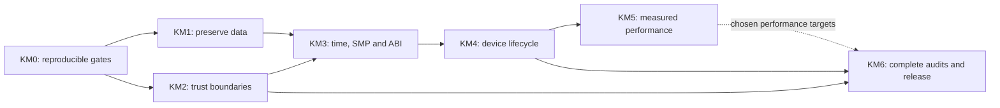

<!-- SPDX-License-Identifier: Apache-2.0 -->
# Kernel modernization roadmap

Plan date: 2026-11-09. Status: proposed implementation program based on the
[source assessment](kernel-assessment.md) and [34-item issue register](kernel-issues.md).
Research/documentation is complete for that bounded snapshot; the fixes and runtime acceptance below are pending.
This plan adds security, correctness and support gates to the [product roadmap](roadmap.md), without changing its
accepted kernel/user ABI or treating earlier feature milestones as production acceptance.

## Outcome and order

The target is a supported system whose ordinary applications cannot cross trust boundaries, whose data survives
failures, whose time/concurrency contracts hold, and whose builds, updates and support can be reproduced. A
booting phone, working calls or a fast UI are valuable milestones; release readiness also requires the gates here.

Start with trustworthy test results and data preservation. Restore least privilege, randomness and trust
boundaries next; run timing/concurrency/compatibility work against those foundations. Add device lifecycle and
measured optimization afterward. Full legacy-component coverage and an operable patch/recovery process close the
release. Small inherited fixes belong in place, marked/licensed according to the kernel rules. Broad rewrites,
new ABI/LP64 transitions and filesystem replacement need separate designs.



The phases below are ordered change packages, not deadlines. Role owners describe responsibility, not assigned
people. Independent read-only audit work may overlap; changes to shared interfaces and acceptance stages remain
sequential. Concurrent implementation needs disjoint ownership or isolated worktrees.

## KM0: Reproducible baseline and trustworthy gates

**Owner:** build/test infrastructure, with kernel reviewer. **Primary issue:** KRN-022.
**Dependencies:** none. Blocks acceptance claims for later work.

- [ ] Capture source commits, dirty-state/diff identity, source lock, image digests, toolchain, board/DTB identity,
  ROM/executable manifest, QEMU version, CPU count, test selection and persistent-image identity per run.
- [ ] Fix runner outcome semantics: distinguish interactive smoke from assertive tests; require a completion
  marker, zero failures, expected test count, and explicit handling of emulator errors and timeouts.
- [ ] Add negative gate controls: missing emulator, launcher error, guest panic, hang, incomplete output,
  deliberate failed test and unexpected skip. A known-bad image must fail.
- [ ] Add a manifest/build route for legacy e32test/f32test groups with per-test pass/fail/skip reasons. Existing
  source files and user-side smoke tests do not substitute for this.
- [ ] Run full-kernel and nkernsa jobs for QEMU virt, with 1/2/8-CPU coverage. Retain Syborg user-side compatibility
  jobs separately. Reconcile the kernel pin with the actual selected checkout and ROM; do not repin over another
  session's uncommitted work.

**Exit:** a clean checkout produces an identifiable candidate and a machine-readable result. Every injected
gate failure fails; a real completed suite passes only after its failure/skip counts are checked. Preserve ELF,
link map, build/census logs, serial log, test manifest/results and image hashes together.

## KM1: Preserve persistent data and repair honestly

**Owner:** legacy F32/filesystem and media integration. **Primary issues:** KRN-007, KRN-008, KRN-009, KRN-010.
**Dependencies:** KM0 for result recording; source proofs/fixtures can start immediately.

- [ ] Separate first provisioning and RAM-drive initialization from normal persistent-volume boot. Remove
  automatic formatting as an ordinary corruption-recovery action.
- [ ] Fix ESTART ScanDrive result handling and sfat32's internal remount/finalization errors as separate patches.
  Specify what a failed-recovery volume exposes: unavailable or bounded read-only recovery, never false healthy.
- [ ] Reproduce each directory-cycle candidate through public operations, extend bounds consistently, and retain
  existing rugged FAT ordering/cache behavior.
- [ ] Build disposable media fixtures for corrupt boot/backup sectors, FAT/FSInfo/directories, cyclic chains,
  interrupted rename/replace/create/delete and repair-time OOM/I/O faults.
- [ ] Specify durable-write/flush behavior through F32, locmedia, the block window and eMMC. Audit arithmetic and
  partition bounds at every layer; preserve the write allow-list.

**Exit:** required recovery never reports false success; damaged initialized media is not silently formatted;
every malformed-media operation terminates within the manifest's CPU/I/O budget. On disposable emulator images,
run at least 100 recorded interruptions spread across metadata/update stages with an oracle for acknowledged
data, allowed partial operations and volume recovery. This is a proposed minimum, not an already-passed test.
Phone write/power-cut work follows the existing [filesystem gates](filesystem.md#safety-gates) and disposable-data
constraints; keep its acceptance evidence separate.

## KM2: Restore least privilege and end-to-end trust

**Owner:** kernel security/IPC, crypto, build/release and DMA specialists.
**Primary issues:** KRN-001–006, KRN-011–016, KRN-021.
**Dependencies:** KM0; storage policy from KM1 before any personal-data use.

- [ ] Publish release/development build profiles and per-image capability/SID manifests. Remove blanket capability
  fallbacks for release; validate core, ROFS and writable-drive binaries and DLL dependency capabilities.
- [ ] Exclude privileged monitor transports/handlers from release, or implement a reviewed development-mode access
  design. USB enumeration and kernel HAL policy must agree.
- [ ] Fix legacy entropy handoff and allocation failures before enabling sources; add characterized entropy,
  source health tests, conservative credit, readiness/reseed behavior and independent DRBG vectors.
- [ ] Close the IPC alias investigation with a demonstrated safe ownership/range argument or a fix and regression.
  Audit forged/stale/reused handles, bad descriptors, integer lengths and request lifetimes. Evaluate opaque
  message tokens as P2 hardening without weakening current ownership checks.
- [ ] Separate privileged ROM mappings and user XIP needs; audit page-table transitions and writable aliases;
  introduce PAN/W^X only with compatibility and negative-access tests.
- [ ] Replace broad DMA mapping with per-device buffer domains and revocation/fault/reset contracts. Verify
  cache maintenance, barriers and lifetime rules for storage, USB and remote processors.
- [ ] Design authenticated boot and update metadata, key lifecycle, rollback state, matching boot/ROFS and safe
  inactive-slot updates. Test actual platform support before proposing any bootloader lock-state change.
- [ ] Design encrypted userdata and secret/key lifecycle, including credential attack resistance, backup/recovery,
  crash-log privacy and hardware trust assumptions.
- [ ] Establish warning baselines and freestanding hardening support; constrain compiler exceptions and add
  target/host instrumentation where useful. Preserve toolchain and ABI assumptions unless separately changed.

**Exit:** unprivileged negative clients fail every privileged operation under the release image; invalid pointers
and protocol lengths cannot panic or corrupt the kernel; entropy failure cannot yield accepted secrets; DMA
outside assigned buffers is rejected; altered/replayed/mixed updates are rejected; protected userdata and keys
remain protected in copied-media and recovery scenarios. All tests have positive controls and raw evidence.
Risk items must be proven closed or corrected, not silently relabeled as fixed. P2 message-token hardening can
remain deferred with its residual address exposure documented.

## KM3: Time, concurrency, VM and legacy ABI correctness

**Owner:** scheduler/VM/architecture maintainers. **Primary issues:** KRN-017–020, KRN-033.
**Dependencies:** KM0; coordinated boundary contracts from KM2. Timer work precedes tickless/power changes.

- [ ] Fix elapsed-tick accounting with bounded expiry delivery; test delayed IRQs, long critical sections and
  callback ordering. Preserve the inherited Advance precondition.
- [ ] Reproduce/explain QEMU's protected-buffer failure with full hashes and RWTRACE. Retain its status until the
  violating implementation/test/emulator invariant is known.
- [ ] Complete or explicitly reject unsupported context APIs. Synchronize live remote CPU register snapshots.
- [ ] Implement and validate FP/NEON ownership/context/fault handling, including kernel SHA use, before enabling
  user FP. Keep soft-float ABI; treat unsupported short-vector compatibility explicitly.
- [ ] Audit SMP memory ordering, lock/context rules, DFC cancellation/death, IPC migration, process exit/unmapping,
  ASID reuse/exhaustion, pinned/shared chunks and OOM paths.
- [ ] Publish actual memory/carve-out maps, physical/pointer conversions, process/thread/handle quotas, time-width/
  wrap behavior and demand-paging support. Reject unsupported addresses; widening requires a coordinated ABI plan.
- [ ] Add bounded peer-stop/crash records, panic-safe logs and reset fallback; test crashes during writes and locks.
  Inventory CPU errata, speculative-execution exposure, EL2 restrictions and available mitigation features.

**Exit:** zero unexplained protected-buffer failures; monotonic/software timers account elapsed time and deliver
each expiry once; no register/FP leakage across threads; no stale translations after tested unmap/reuse; resource
exhaustion follows specified errors. Proposed minimum soak is 24 hours per supported candidate configuration
with mixed SMP/IPC/VM/I/O and all skips counted. A shorter focused run is development evidence, not this acceptance.

## KM4: Independent hardware lifecycle and recovery

**Owner:** board/SoC drivers and telephony/audio services.
**Primary issues:** KRN-024, KRN-027, KRN-029, KRN-030, KRN-032.
**Dependencies:** KM1–KM3, particularly timer, DMA, trust and crash contracts.

- [ ] Make USB and every supported peripheral start without relying on ABL state; define clocks, rails, reset,
  IRQ/DFC ownership, timeouts, teardown and failed-start retry.
- [ ] Add charger/battery/thermal policy, sleep/wake vote aggregation, key/touch wake and CPU suspend/retirement
  with explicit timer and retained-state contracts.
- [ ] Close connected-call LTE recovery causally, and define modem/DSP/service restart and persistent-data policy.
- [ ] Add audio calibration/provenance, safe gain limits and amplifier/protection fault handling.
- [ ] Retain FS5b slot retry, good-boot marking, fallback and mismatched-ROM rejection as regressions, without
  conflating A/B recovery with authenticated rollback prevention.

**Exit:** proposed minima are 20 consecutive installed cold/warm boot cycles and 100 suspend/resume cycles,
plus USB reconnect, peripheral failure, modem restart and repeated call-route tests. Each must identify the
tested firmware/build and startup state. Establish measured overnight idle/charger/thermal behavior and an
explicit daily-use power budget before claiming a daily phone. These are future acceptance targets; this audit
did not access or write the phone. Existing filesystem/telephony write gates remain applicable.

## KM5: Measured performance and maintainable board support

**Owner:** subsystem maintainers with performance/test support.
**Primary issues:** KRN-025, KRN-026, KRN-028, KRN-031.
**Dependencies:** correctness gates for each affected subsystem; power baselines from KM4.

- [ ] Measure context-switch/exec/IPC costs, SWP traps, allocator contention, IRQ/DFC latency, memory pressure,
  file-server/cache/storage stalls, boot time, CPU placement and idle energy.
- [ ] Prioritize application-visible p95/p99 delay and power, then test bounded asynchronous media queues, interrupt
  I/O, merging/read-ahead, tickless idle, feature-detected atomics or cache/allocator changes as indicated.
- [ ] Close input loss with counters/backpressure and trace odd-width stride from guest programming to capture.
- [ ] Follow all existing baseport registry/object-name/layering debts in a behavior-preserving pass, with explicit
  driver presence/start order checks. Coordinate shared-file moves after concurrent driver work settles.

**Exit:** every adopted optimization has matched before/after evidence, resource bounds and a correctness/power
regression result. Record median/tail latency, throughput, memory and energy, with clock/thermal conditions.
Frame latency should meet the existing [smooth UI budget](smooth-ui.md#goal-and-budget); kernel changes alone
do not establish that result. Leave unmeasured optimizations deferred. None of these items authorizes weakening
metadata flushes, validation, fairness, isolation or failure handling to improve a benchmark.

## KM6: Complete legacy audits and operate a supported release

**Owner:** release/security, legacy subsystem owners and product maintainers.
**Primary issues:** KRN-023, KRN-034. **Dependencies:** applicable KM0–KM4 gates and chosen performance targets.

- [ ] Finish every release-reachable legacy surface in the assessment coverage matrix: parsers/loaders, descriptors/
  heap, filesystem/ROFS, LDD/PDD requests, shared memory/VM, IPC and scheduling. Record reviewer, exact source,
  operations, tests, findings and exclusions; absence of findings is not a blanket security guarantee.
- [ ] Fetch the pinned security/networking/user services and inventory versions, patches, algorithms, certificate/
  time validation, authentication and privileged installer/update paths. Provide host parser/fuzz harnesses and
  a negative-test client for each exposed boundary.
- [ ] Maintain an SBOM/advisory ledger: applicability requires modified-code/link/input-path evidence. Resolve the
  crash-logger zlib candidate before enabling it; review dormant legacy components when release scope changes.
- [ ] Decide firmware maintainability for modem/DSP/TEE/bootloader. If the target cannot meet the declared threat/
  patch model, use supportable hardware for the product and retain bonito's development status.
- [ ] Publish release manifests, supported hardware/configurations, known limitations, recovery/backup instructions,
  vulnerability reporting, triage/patch ownership and a support lifetime. Respect existing license and image-
  distribution constraints, including the current UI renderer decision.
- [ ] Run a fresh independent review using the specification, baseline, incremental diff and raw test results.
  Resolve findings before changing an issue to closed.

**Exit:** no open P0/P1 in the declared supported scope; no unexplained failing required test or hidden skip;
all dormant/out-of-scope components are demonstrably excluded; update/recovery and security response have an
owner and exercised runbook. P2 deferrals carry a reason, remaining risk and revisit trigger. A supported-release
claim must name its exact image/firmware/hardware matrix rather than the project in general.

## Legacy test restoration matrix

All paths below are relative to the kernel repository. These are existing source candidates, not commands that
already build/run through neo. KM0 must establish eligibility, ROM inclusion and result collection. Preserve test
intent; record incompatible assumptions and replacements instead of turning failures into skips.

| Contract | Existing source starting points | Additional cases needed | Phase |
|---|---|---|---|
| Capabilities/IPC/user copies | kerneltest/e32test/secure/t_platsecconfig.cpp; secure/t_ipcsafety.cpp; misc/t_ipccpy.cpp | Least-capability HAL/driver clients, alias/range overflow, cancel/death/migration | KM2 |
| Entropy/DRBG | kerneltest/e32test/random/t_securerng.cpp; random/t_entropysources.cpp | Forced publication race, initialization OOM, source health/readiness, independent vectors | KM2 |
| Timer and DFC | kerneltest/e32test/prime/t_timer.cpp; active/t_timerduration.cpp; nkernsa/testdfc.cpp | Delayed IRQ catch-up, bounded expiry, cancel/close/death, later sleep/resume | KM3 |
| Suspend/kill/SMP | kerneltest/e32test/nkernsa/fastmutex.cpp; nkernsa/threadbasic.cpp; nkernsa/tiedevents.cpp; smpsoak/t_smpsoak.cpp | Exact skmpar reproduction, 1/2/8 CPUs, repeated mixed load | KM3 |
| VM and sharing | kerneltest/e32test/mmu/t_sharedchunk.cpp; mmu/t_sharedio.cpp; mmu/t_shbuf.cpp; mmu/t_codepaging.cpp; demandpaging/t_datapaging.cpp | ASID reuse, pinned close/unmap, OOM, stale translations, enabled paging only | KM3 |
| FAT/recovery | kerneltest/f32test/filesystem/fat/t_fatcorrupt.cpp; server/t_scan.cpp; server/t_vfat.cpp | Corrupt cyclic images, recovery failures, no-autoformat, metadata interruption oracle | KM1 |
| Storage/cache performance | kerneltest/f32test/server/t_filecache.cpp; bench/t_fat_perf.cpp | Queue cancellation, fairness, durability, mixed tail latency | KM5 |

## Existing commands and result handling

These commands are available today, run from the build checkout on the documented build host with its mounted
user-side volume and pinned images. They were not executed for this documentation audit.

```sh
./neo nkernsa qemu
./neo qemu 600 kernel
./neo kernel qemu
./neo qemu 60
NKSA_MAIN=select NKSA_TESTS=skmpar NKSA_RWTRACE=1 ./neo nkernsa qemu
./neo qemu 600 kernel
```

Until KRN-022 is fixed, these runner exit codes alone are not acceptance. Inspect kernel/out/kernel-qemu/serial.log
or kernel/out/ekern-qemu/serial.log, require the intended completion record and zero failures, and reject faults,
unexpected skips and missing output. The nkernsa completion prefix is
`EKA2/arm64: nkernsa finished, failures:`; parse the full numeric value and test selection.

The current neo wrapper does not forward SMP or an expected marker to its qemu invocation. For explicit CPU
counts/markers use the existing script inside the toolchain container, from the kernel checkout, for example:

```sh
OUT=out/kernel-qemu SMP=8 sh baseport/arm64/tools/run-qemu.sh 600 'EKA2/arm64: nkernsa finished, failures:'
```

That prefix check still does not assert a zero failure count. KM0 must provide the complete parser and negative
controls before this becomes a gate. Full-kernel phone builds use the established
`DTB=../private/bonito.dtb ./neo kernel bonito` path; actual RAM boot/installation and storage tests follow their
existing device-state, retry and write-approval rules. Kernel source fixes require the documented QEMU/full-kernel
and applicable phone gates, then an intentional build/source pin update after the kernel commit.

For every result retain the exact command and environment, exit status, raw output, candidate/test hashes,
expected/actual counts, skips and reason, artifact paths, and reviewer. Redact device identifiers and secrets
before publication without discarding private diagnostic evidence.

## First implementation batch

1. Fix runner outcome validation and establish a clean, pinned test candidate (KRN-022).
2. Add disposable failure fixtures, remove automatic formatting from ordinary persistent boot, and fix both
   recovery error layers (KRN-007/008/009); reproduce the directory-cycle cases (KRN-010).
3. Fix the two small inherited entropy defects before connecting collectors (KRN-004/005), then validate the
   entropy/readiness/DRBG chain (KRN-003/006).
4. Establish capability manifests and release debug policy (KRN-001/002); resolve the alias investigation
   (KRN-011). Advance the remaining KM2 trust work with explicit dependencies.
5. Fix timer accounting and close the scheduler reproduction before sleep/tickless/performance changes
   (KRN-017/018).

This order produces bounded, independently reviewable changes without waiting for a wholesale kernel rewrite.
