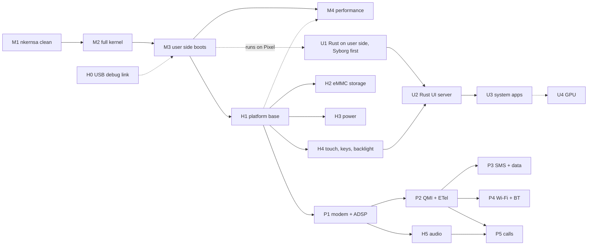

# Roadmap: EKA2 on the Pixel 3a XL, to a daily phone with a Rust UI

Written 2026-11-05. It continues `port-map.md`, which plans the first milestone in detail, and goes all the way to a
phone you can use every day.

- Sizes and durations marked **GUESS** are estimates.
- Hardware facts marked **DTB** come from the device tree appended to `probes/out/probe-a64.img` (model "Google Pixel 3a
  XL (with SDC panel)"; it uses mainline-Linux-style `qcom,sdm670-*` compatibles). To dump it, find the `d00dfeed`
  magic in the image, then run `dtc -I dtb -O dts`.
- Anything else marked **unverified** has not been checked.

## Kernel modernization and release readiness

The 2026-11-09 [source assessment](kernel-assessment.md) and [issue register](kernel-issues.md) add a
[modernization track, KM0–KM6](kernel-modernization.md): trustworthy tests, data preservation, security boundaries,
time/SMP/ABI correctness, device lifecycle, measured performance and release support. It covers inherited EKA2/F32
defects as well as port shortcuts and maps every section of known-issues.md.

The milestones below record feature bring-up and historical checks. A supported-release claim additionally needs
the modernization gates; ROFS hashes and A/B recovery do not by themselves authenticate boot images or updates.
The audit changed documentation only; its proposed fixes and runtime acceptance remain pending.

## Goal and fixed decisions

**Goal:** a daily phone: calls, SMS, mobile data, Wi-Fi, a touch UI, and a battery that lasts a day.

| Decision | Made by | Choice |
|---|---|---|
| Kernel | existing | The 2010 SMP EKA2 (kernelhwsrv `201043_12`), as an ILP32 AArch64 kernel (`port-map.md`). |
| User side | user | Keep the 2010 Symbian user side, built 32-bit ARM by Phorepoc and run unchanged at AArch32 EL0: file server, servers, eshell, old apps. |
| UI | user | A **new Rust UI server** replaces the old window server and UI. The system apps are written in Rust. |
| Driver language | user: "a mix"; the split is **my call** | See next section. |
| Hardware reference | **my call** | Mainline Linux (sdm670/sdm845), postmarketOS and freedreno are read for register layouts and protocol behaviour only. No code is copied from them (GPL vs EPL/Apache). |

## Driver language split (my call)

The kernel is ILP32: 64-bit code with 32-bit pointers. Rust has no ILP32 AArch64 target, so Rust code can't be linked
into the kernel safely. That gives one rule:

> **Timing-critical code, or anything needed before the user side boots → C++ in the kernel.
> Protocol logic and policy → Rust on the user side.**

| Layer | Language | Examples |
|---|---|---|
| Kernel drivers (EKA2 LDD/PDD) | C++ | GIC and timers (done), clocks and regulators over RPMh, SPMI to the PMICs, GENI I2C/SPI, GPI DMA, SDHCI/eMMC media driver, DWC3 USB, DSI panel and backlight power, SCM calls to TrustZone, remote-processor loader, GLINK/SMEM transport |
| Generic `hwaccess` LDD | C++ (small) | Gives a user-side Rust driver a mapping of a register block and an interrupt-to-request notification. It exists so most new drivers don't need kernel code. |
| User-side drivers and stacks | Rust (`armv5te-none-eabi`, `no_std` + `e32` crate) | Synaptics RMI4 touch protocol, battery and charger policy, QMI client, modem and telephony logic, Wi-Fi control, the UI server, all system apps |
| Glue to old Symbian frameworks | thin C++ | ETel TSY plugin over Rust QMI; ESOCK/TCPIP6 packet interface over the modem and Wi-Fi data paths |

Rust user-side code can be unit-tested on a PC: protocol parsers, QMI, UI layout. Kernel C++ is tested on QEMU first,
then on the phone.

## Hardware inventory (what each stage talks to)

| Block | Where | Status |
|---|---|---|
| CPUs: 8 cores, MPIDR Aff1 0–7, PSCI over SMC | `board/pixel_bonito.cpp` | **working** |
| GICv3 at `0x17a00000` / `0x17a60000`, virtual timer PPI 19 | same | **working** |
| Framebuffer: continuous splash at `0x9c000000`, 1080×2160 a8r8g8b8 | same, `probes/README.md` | **working** (left on by the bootloader) |
| RAM: `memory@80000000` | DTB (the bootloader fills in the size) | Size and ranges **unverified**. Expect 4 GB from `0x80000000`, so about 2 GB sit below the 4 GB physical limit of the 32-bit `TPhysAddr`. |
| Storage: **eMMC**, `qcom,sdm670-sdhci` (sdhci-msm-v5, CQHCI, ICE) at `0x7c4000` | DTB | no driver |
| Touch: **Synaptics RMI4** on I2C, address `0x20` | DTB | no driver |
| PMICs: **PM660** (charger, RRADC, GPIO, regulators, haptics) and **PM660L** (GPIO, WLED backlight, LPG, flash LED, WCD analog codec) on SPMI at `0xc440000` | DTB | no driver |
| Display: MDSS / DPU / DSI controllers | DTB | splash only |
| USB: DWC3 + QUSB2 PHY | DTB | no driver |
| Modem: `remoteproc@4080000` `qcom,sdm670-mss-pil`, firmware `qcom/sdm670/sargo/mba.mbn` + `modem.mbn`, GLINK edge, SMEM at `0x86000000` | DTB | no driver |
| ADSP (audio DSP) memory at `0x95800000`, LPASS SMP2P; CDSP at `remoteproc@8300000` | DTB | no driver |
| GPU: **Adreno 615** + GMU, own SMMU | DTB | no driver |
| Bluetooth: `qcom,wcn3990-bt` | DTB | no driver |
| **Wi-Fi: not in this DTB** | DTB | **unverified**. WCN3990 Wi-Fi on SDM845-family chips is normally driven via the modem subsystem and QMI. |

## Tracks and stages

Four tracks. Track K runs alone until M3. After that, H, U and P run in parallel.

### Track K: kernel

**M1: nkernsa clean on the phone** (in progress)
- Work: fix the 4 remaining TT2 timeslice failures (`7fe0958`). Finish the idle and balancing work (`2e08ec8`, `dafbc87`).
- Exit: full nkernsa suite with **0 failures** on the phone. QEMU passes everything except the timing checks QEMU can't
  meet (its vCPUs don't advance in lockstep).

**M2: full kernel (`ekern`) on QEMU, then on the phone**
- Status (2026-11-06, `211931b`): **the full kernel boots on QEMU and on the Pixel, on all 8 cores**. Bootstrap
  (`boot/a64boot.cpp`) → `_E32Startup` → `KernelMain` → kernel threads, 1 ms tick, timer DFC, then every CPU through
  PSCI `CPU_ON` (`NKern::BootAP`). The self-test extension passes (`XTRAP` around a data abort returns -38;
  4 × `NKern::Sleep(100)` = 404 ticks; one sleeper pinned to each CPU, 8/8 back). Build: `tools/build-ekern.sh`.
- Status (2026-11-06, `06c3cb8`): **user mode works on QEMU and on the Pixel**. The first user process (an
  ARMv5TE test program started by `exstart` as the ROM secondary) runs at AArch32 EL0. It makes fast and slow exec
  calls (with handle preprocessing), is preempted by the tick at EL0, and has its SWP and misaligned LDRD emulated by
  the kernel (`ekern/a64e_a32fix.cpp`).
- Status (2026-11-06, `e2f9b8f`): **the real 2010 user side boots on QEMU and on the Pixel**.
  - **Boot chain:** efile (F32) → estart → C: (FAT on the internal RAM drive).
  - **Tests:** the e32-rs Rust test EXE passes 6/6: alloc, timer, async, threads, semaphore, fs.
  - **Where the images come from:** the `symbian-2010` build (read-only), packed by `tools/build-userrom.sh` into a
    ROM section (pdk `rombuild.py --section`) that the kernel image carries.
  - **Next:** eshell on the phone screen (a console, the display HAL, a font, input).
- Status (2026-11-06, `7f63ec2`): **eshell's prompt is on the phone screen**.
  - **Stack:** the 2010 window server drives it: wserv + fbserv + ecom + econswserv, the `symbian-2010` Syborg
    minigui ROM's own image list.
  - **Kernel:** a new display HAL (`board/a64_display.cpp`) maps the framebuffer for the user side; the kernel log
    keeps the bottom strip of the phone screen.
  - **QEMU:** commands are typed over the serial port (`board/a64_serialkbd.cpp`); `dir z:\sys\bin` runs.
  - **Next:** input on the phone (touch or the volume keys), then the Rust UI (neoui) as the shell's successor.
- Status (2026-11-06, `366f63d`): **input on the phone, and the Rust UI is the shell**.
  - **Keys:** power and volume over the PMIC's SPMI bus.
  - **Touch:** the Synaptics RMI4 touchscreen over GENI I2C. The kernel brings up the clocks, pins, supply and reset
    that the bootloader leaves off.
  - **neoui:** the Rust UI server (SYSSTART) replaces eshell, draws its launcher on the phone and takes the taps.
  - **Next:** neoui still scales tap x by 3/4 on the Pixel, because it applies the Syborg pointer
    correction (Rust side). After that: storage (H2) and power (H3).
- Status (2026-11-07, kernel `2594ed8`): **H0 debug link done; the eMMC reads on the phone (H2.2)**.
  - **H0:** a USB CDC-ACM console (DWC3) with a kernel monitor (`log`, `peek`/`poke`, `blk`, `tap`, `shot`,
    `fastboot`, …), `tools/phone.py` on the Mac, and an always-on watchdog in `AUTOFASTBOOT` builds, so tests boot,
    report and return to fastboot unattended.
  - **lastlog:** the log ring lives in RAM that survives a reset, so a crash's log is read on the next boot.
  - **H2.1:** a block layer + media driver; C: persists on QEMU (virtio-blk).
  - **H2.2:** the eMMC host (no SDMA on this core: ADMA2) reads EXT_CSD and the real GPT (userdata = 51 GB),
    with the RPMh votes (CX, BCM SN8) that the bootloader drops, re-made by a minimal RPMh client.
  - **Next:** H2.3, writes bounded to userdata and C: on it (the first write is asked for first), then H3 power.
- Status (2026-11-07, kernel `8629702`, H2.3): **C: is on the phone's eMMC, and files survive a reset**.
  - `C:` = the first 2000 MB of `userdata`, FAT16, because `ELOCAL.FSY` is still the old `sfat`. It grows to 4–8 GB
    FAT32 with FS1 ([filesystem.md](filesystem.md)).
  - Writes are checked twice (the window layer and the eMMC driver), so only that window can be written.
  - A file made in eshell on one boot is listed after a reset and a fresh RAM boot.
  - Verified with the eshell ROM (persistence) and the neoui ROM (the launcher, with `C:` on the eMMC).
  - `EMMC_C=1` is not the default build yet.
- Status (2026-11-07, kernel `6c404ef`, build `584ba4e`, FS1): **`C:` is 8 GB FAT32 with long names**.
  - `ELOCAL.FSY` is built from `sfat32` (FAT12/16/32, VFAT long names, rugged FAT, ScanDrive); `mkfat.py` writes long
    names into the Syborg `c_drive.img` too.
  - `C:` starts on the first 4 MiB boundary inside `userdata` (+7168 sectors), leaving room for FS3's MBR; the
    format aligns its data area to the eMMC's 512 KB erase group.
  - Verified: QEMU (8 GB FAT32, 256 MB FAT16, the RAM drive, neoui, the Syborg ROM); the phone (a long-named
    directory survives a reset, and the neoui ROM reaches the launcher).
  - **Next:** FS2 (eMMC speed + the partition allow-list), FS3 (`C:` + `E:`), then H3 power.
- Status (2026-11-07, kernel `fc0c929`, FS2): **the eMMC runs 8-bit DDR52: 70 MB/s read, 39 MB/s write** (was 2 MB/s).
  - The mode is raised at boot and verified by re-reading EXT_CSD; a cached DMA bounce buffer doubled the speed.
  - Writes are limited to an allow-list of GPT partitions (`userdata` only enabled; `system_*`/`vendor_*` wait for
    gate G1). New monitor commands: `blk speed [raw]`, `blk guard <lba>`, `blk mode <0-2>`.
  - **Next:** FS3 (`C:` + `E:` on `userdata`, TRIM), then FS4a/FS5a, then H3 power.
- Status (2026-11-07, kernel `92586a0`, FS3): **H2 storage done: `C:` (8 GB) and `E:` (42 GB) on the eMMC**.
  - An MBR in userdata sector 0 splits it; `C:` kept its place and files; `E:` is mass memory, FAT32.
  - TRIM from FAT's delete notifications; files survive a reboot and a watchdog reset during a copy.
  - **Next:** H3 power; the rest of the storage plan (FS4a `Z:` from ROFS, FS5a integrity, the FS6 spike) alongside.
    FS4b/FS5b need the owner's approval (gates G1–G3 in [filesystem.md](filesystem.md)).
- Status (2026-11-08): **FS4 and FS5 done; the phone is installed and updates itself safely.**
  - **FS4:** `Z:` = the core ROM in `boot_x` + ROFS in `system_x`.
  - **FS5a:** every `Z:` block hash-checked, with the CPU's SHA-256.
  - **FS5b:** A/B slots. The kernel picks `system_<slot>` and counts tries; neoui marks a good boot; a bad update
    rolls back by itself. Tested on the phone.
  - **Dev tools** app on the phone: the kernel logs, saving them to `E:\logs`, the console overlay, the slot state.
  - **Parked:** USB power on a normal boot ([known-issues.md](known-issues.md)).
  - **Next:** FS6 (`E:` over USB), the on-phone updater, H3 power.
- Status (2026-11-08): **H3a done: power off, restart, and a clock that survives both** (kernel `bee9830`, neoui
  `724475a` + `fafb232`, e32 `c5fda36`; [rust-integration.md](rust-integration.md#h3a-power-off-restart-and-the-clock)).
  On the Pixel (RAM boot): the PM660 RTC reads and counts; a power-off from the Power menu stays off; after it,
  neoui set the clock from the RTC and `clock.dat` to within ~2 s. The rest of H3 (charger, battery, suspend,
  screen off) is still open.
- Work, from `port-map.md` §2–§4 and §7:
  - exec gate: read the SVC opcode with `LDTR` at `ELR_EL1-4`; bit 23 = fast/slow; Thumb SVC has an 8-bit immediate;
  - `umemget`/`umemput`, `TExcTrap`, `EpocThreadFunction`, user entry;
  - flexible memory model on VMSAv8 with ASIDs and IPC alias redesign;
  - AArch32-EL0 fix-ups ported from Phorepoc `ekern_seam.cpp:1162-1603` (SWP/SWPB, misaligned LDRD/STRD/LDM/STM, VFP
    short vectors).
- Reuse: Phorepoc x86-64 ekern backend as the template (`xe_kernel.cpp`, `xe_mmu.cpp`, `xk_irq.cpp`).
- Size: ~3–5k new lines (**GUESS**, `port-map.md` §7).
- Exit: e32test core groups pass on QEMU and on the phone.

**M3: user side boots**
- Work:
  - ROM image from Phorepoc's 32-bit ARM user side (the pdk tools are on ZimaOS);
  - file server on a RAM drive;
  - eshell (FShell later) on the framebuffer console;
  - a temporary input path: volume keys as GPIO, or text over the USB serial link from H0.
- Exit: a shell prompt on the phone screen; basic f32test runs.
- Repos: when the user side is built with `phe`, split this repo Phorepoc-style. The arm64 port and the Qualcomm
  drivers go into a SoC repo (`adaptation-sdm670`), and the Pixel settings and image recipes into a board repo
  (`board-bonito`), both under `neosymbian`.

**M4: performance** (any time after M3)
- ✅ **big.LITTLE-aware balancing** in `nkernsmp/nk_bal.cpp`: 2 gold + 6 silver cores. Busy threads go to gold, background
  work to silver. Done for the UI (smooth-ui S3d, 2026-11-08): each CPU weighs by its capacity and clock now.
- **LSE atomics** (ARMv8.1+ `CAS`/`LDADD`) in `a64s_atomics.cpp` instead of LDXR/STXR loops.
- **Tickless idle**: don't wake idle cores every 1 ms.
- **CPU frequency scaling** through the SoC's cpufreq hardware block (needs H1). Started (smooth-ui S3c, 2026-11-08):
  `qcom_cpufreq.cpp` sets the OSM steps, top on input and ABL's 3 s later; a governor comes with power (H3).
- **More than 4 GB physical**: widen `TPhysAddr` to 64 bits in the memory model. Only if the RAM map (unverified)
  puts memory we need above 4 GB.
- Exit: before/after numbers from the nkernsa benchmarks, boot time, and idle current.
- The UI's needs from M4 (clocks, placement, FP/NEON for user code) are stages S3–S4 of [smooth-ui.md](smooth-ui.md).

### Track H: hardware

| Stage | Work | Exit |
|---|---|---|
| **H0 debug link** (early, ideally before M3) | DWC3 in device mode as a USB serial console, so logs leave the phone without the screen | Kernel logs readable on the Mac over USB |
| **H1 platform base** | RPMh (clocks, regulators, bus votes), SPMI PMIC arbiter, TLMM GPIO, GENI I2C/SPI, GPI DMA, SCM calls to TrustZone | Can talk to PM660 and to an I2C device |
| **H2 storage** | SDHCI-msm eMMC media driver (CQHCI later), read the GPT, `C:` on `userdata`; then the file system plan ([filesystem.md](filesystem.md)): FS1 FAT32 plugin, FS2 HS200, FS3 `C:` + `E:`, FS4 `Z:` on ROFS, FS5 A/B updates, FS6 USB | Files written in Symbian survive a reboot and a power cut |
| **H3 power** | PM660 charger + RRADC battery reading (Rust policy); suspend and resume (PSCI CPU_SUSPEND / system suspend); screen off | Phone idles a night on battery and wakes on the power key |
| **H4 display + input** | Synaptics RMI4 touch (I2C; **done 2026-11-06** in kernel C++, polled; Rust behind `hwaccess` later); power and volume keys (**done**, SPMI); WLED backlight on PM660L; DSI panel on/off. Keep the bootloader's splash framebuffer as scan-out until a DPU driver is needed (vsync, double buffer, hardware planes: [smooth-ui.md](smooth-ui.md) S5). | Touch coordinates reach a user-side process; backlight dims |
| **H5 audio** | ADSP remote processor; audio path through LPASS + PM660L WCD codec; speaker and earpiece | Play a tone through the earpiece |
| **H6 haptics, LEDs, sensors** | PM660 haptics, LPG and flash LED, sensors (**unverified** which) | Vibrate on touch |

### Track U: Rust UI

The full plan is in [rust-integration.md](rust-integration.md) (phases R0–R7). It is developed now on QEMU Syborg,
with the real 2010 ARM user side, and moves to the Pixel after M3.

**U1: Rust on the Symbian user side** (now on Syborg; on the Pixel after M3) = R0–R3
- Build path:
  - target **`armv5te-none-eabi`**, soft-float, matching the user side's `-march=armv5te` ABI. **Never `eabihf`:** it
    passes floats differently and breaks calls into Symbian libraries;
  - Rust staticlib → link with symbian-2010's toolchain → its emitter (ELF → E32Image from the frozen `.def` files)
    → E32 image in the ROM.
- `e32` crate:
  - raw exec calls (`svc` with the fast/slow bit);
  - a global allocator on an `RHeap` or a chunk;
  - threads, semaphores, timers;
  - IPC client and server (`RSessionBase`/`CServer2` equivalents with a Rust API);
  - descriptor conversion at the boundary.
- Exit: a Rust "hello" EXE runs from eshell, and a Rust server answers a C++ client.

**U2: Rust UI server** (R4–R6 on the Mac and Syborg now; on the Pixel = R7, needs U1 + M3 + H4)
- Owns the framebuffer and touch input; replaces the old window server.
- Apps draw into their own shared chunks; the server composites with damage tracking, then does a CPU copy to the
  splash framebuffer. Shared chunks are the EKA2 equivalent of shared memory.
- Apps talk to it over Symbian IPC: create surface, input events, focus, notifications.
- UI toolkit: **Slint** with its CPU-only software renderer (needs no GPU or operating system).
- Exit: a Rust launcher drawn and scrollable by touch. Target 60 fps at 1080×2160; measure it, CPU only.
  Measured at ~15 fps (R9); the way to 60 fps is [smooth-ui.md](smooth-ui.md).

**U3: system apps in Rust**
- Launcher, status bar (battery from H3, signal from P2), settings, dialer, messages, contacts, file manager.
- Old Symbian text apps keep running from a terminal app.
- Shell services (settings store, notifications, home pages with widgets, pin/unpin): designed in
  [neoui-shell.md](neoui-shell.md), planned.

**U4: GPU** (stretch)
- Adreno 615 + GMU + its SMMU. Kernel part in C++; command-stream builder in Rust. Freedreno is the reference.
- Until then, everything renders on the CPU. Stage S6 of [smooth-ui.md](smooth-ui.md); its S2 and S5 cover a 2D UI first.

### Track P: phone

The full runbook, with hardware facts, steps, exit tests and failure modes, is [telephony.md](telephony.md) (stages
C0–C12). The stage names below are kept because the dependency graph uses them:

| Stage | telephony.md | Exit |
|---|---|---|
| **P1 remote processors** (needs H1) | C0–C4: backups, Linux reference run, SCM/SMEM/SMP2P/GLINK, MSS boot, rmtfs/pd-mapper/tqftp | The modem is up and answers QMI |
| **P2 QMI in Rust** | C5: `modemsrv` + dialer (no ETel at first) | Operator and bars in the status bar; calls ring and answer |
| **P3 SMS and mobile data** | C9, C10 | SMS round-trip; a web page over LTE |
| **P4 Wi-Fi + Bluetooth** | not in telephony.md | Join a WPA2 network. WCN3990 Wi-Fi runs through the modem subsystem and QMI (ztOS: "WIFI-HW missing" until rmtfs + tqftpserv ran), so it comes after P1 |
| **P5 voice calls** | C6–C8, C11 | Two-way call audio. 2026-11-08: the owner's network still has 3G, so calls use CSFB first. VoLTE is the C11 stretch. **C6 done 2026-11-09**: two-way call audio on the earpiece and loudspeaker |

## Dependencies

## Suggested order and checkpoints

| # | Stages | You can now… |
|---|---|---|
| 1 | M1 → M2 → H0 → M3 | type commands into a Symbian shell on the phone |
| 2 | U1 → H1 → H2 → H4 → U2 | use a touch-driven Rust launcher, with files that persist |
| 3 | H3 → M4 → U3 | leave it on battery all day; everything feels fast |
| 4 | P1 → P2 → P3 | see signal, send SMS, browse over LTE |
| 5 | P4 → H5 → P5 | use Wi-Fi, hear audio, and make calls (if the VoLTE risk allows) |
| — | U4 | GPU acceleration, any time after checkpoint 3 |

## Unverified: check before the stage that needs it

| Question | Needed for | How to check |
|---|---|---|
| RAM ranges and size (the DTB leaves the size to the bootloader) | M2 memory map, M4 | Dump the DTB the bootloader passes at boot (x0) on the phone |
| Which Phorepoc user-side packages exist and build: ETel, SMS stack, ESOCK/TCPIP6, FShell | M3, P2, P3 | List the Phorepoc ROM contents / build recipes on ZimaOS |
| WCN3990 Wi-Fi on sdm670: firmware path and control path | P4 | Mainline sdm845 DTBs + postmarketOS notes for sargo/bonito |
| VoLTE feasibility on the target carrier | P5 go/no-go | Carrier's 2G/3G status; postmarketOS VoLTE status on Qualcomm |
| Sensors present on bonito | H6 | Full DTB from the bootloader / stock kernel |
| Rust `armv5te-none-eabi` objects linking through symbian-2010's toolchain and emitter | U1 | R0 spike (`rust-integration.md`) |
| Slint software renderer speed at 1080×2160 on one Kryo core | U2 | Benchmark on Linux on similar ARM hardware, or on the phone after U1 |
