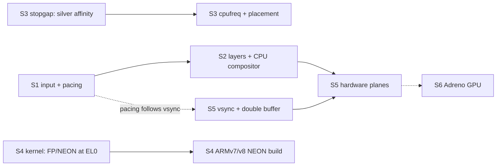

# Smooth UI: from 15 fps redraws to 60 fps on the Pixel

**Status: plan (2026-11-07).** This comes from a read-through of neoui, e32-rs and the kernel after the R9 speed
measurements ([rust-integration.md](rust-integration.md#r9-neoui-speed-on-the-phone-measured)). No code has changed
yet. Stages S1–S6 below are the work list. Each stage has an owner, an exit check, and an **estimate** of what it
gains. Estimates are not measurements until the stage's exit check says so.

Paths name the repository first (`neoui`, `e32-rs`, `kernel`), then the path inside it.

## Goal and budget

- **60 fps = 16.7 ms per frame**, at the user side's 1080×1800 on the Pixel.
- **Today** (R9, silver cores):
  - a full frame takes 60–68 ms to render;
  - menu ↔ home transition frames take up to 140 ms on silver and 467 ms on gold;
  - the copy of a full frame to the framebuffer takes **4 ms**.
- **The key fact:** copying finished pixels already fits the budget four times over. Drawing them every frame does
  not. Smooth phone UIs (iOS, Android, Symbian^3's own NGA) draw content once into layers and animate the layers.
  neoui redraws everything, every frame.

## Why it isn't smooth

| # | Problem | Evidence | Owner |
|---|---|---|---|
| 1 | One full render per input event. A drag sends one move every 10 ms, and each move is followed by a render of 60+ ms. | `neoui` `symbian/src/lib.rs`, the `rt::select` loop in `main` | neoui |
| 2 | The kernel's event queue holds 40 events and **drops new ones when full**. That loses Up events: "a press paired with a later release" (R9). | `kernel` `kernel/eka/kernel/sinit.cpp:46` (`KMaxEventQueue=40`), `kernel/eka/kernel/eventq.cpp` `Kern::AddEvent` | kernel |
| 3 | Frame pacing is a fixed 33 ms wait *after* the render, so the frame period is render + 33 ms, and fps can never pass 30. | `neoui` `symbian/src/lib.rs` `FRAME_US` | neoui |
| 4 | Nothing is kept between frames. Home page swipe, menu ↔ home fade and every list scroll redraw the whole area each frame. | `neoui` `ui/screens/home.slint:141` (`animate x`), `ui/shell.slint:35` (`animate opacity`), 21 `Flickable`s in `ui/screens/` | neoui |
| 5 | CPU clocks are never set. The gold cores run 2.2× *slower* than silver, probably left at a low clock by ABL (unverified). | `kernel` `baseport/arm64/common/specific/a64_variant.cpp:91` (hard-coded nominal clock) | kernel |
| 6 | Threads move freely across all 8 cores, so neoui lands on the slow gold cores. The balancer ignores core capacity. | `kernel` `kernel/eka/kernel/sthread.cpp:614` (`KCpuAffinityAny`), `kernel/eka/nkernsmp/nk_bal.cpp` | kernel |
| 7 | No FP/NEON for user code: CPACR_EL1 is never set, and no V registers are saved on a context switch. This forces the soft-float ABI and an ARMv5TE build. | `kernel` `kernel/eka/nkernsmp/arm64/vectors.S` (x0–x30 only), `a64s_ncsched.cpp:560` (`CompleteContextSave` stub) | kernel |
| 8 | The ARMv5TE build has no NEON, no LDREX/STREX and no hardware divide. Atomics and locks go through the kernel: every Rust alloc/free makes 2 exec calls, and euser's `RFastLock` uses SWP, which ARMv8 traps and the kernel emulates. | `e32-rs` `crates/e32/src/heap.rs` (`mutex_wait`/`mutex_signal`); `kernel` `kernel/eka/kernel/arm64/a64e_a32fix.cpp` `EmulateSwp` | e32-rs, kernel |
| 9 | One uncached framebuffer with no vsync, no flip and no double buffer, so updates can tear and there is nothing to pace frames against. | `kernel` `baseport/arm64/common/specific/a64_display.cpp:124` (`EMapAttrBufferedC`); no MDP/DPU register is touched | kernel |
| 10 | Touch is polled every 10 ms over 100 kHz I2C with a busy spin. Every press and release calls `Kern::Printf`, which prints with interrupts off. | `kernel` `baseport/arm64/bonito_variant/specific/a64_touch.cpp:282` (`KPollMs`), `:345` (the print); `baseport/arm64/sdm670_assp/qcom_geni_i2c.cpp` | kernel |

**Correction to R9's "next" list:** Slint's software renderer draws pixels with integer math. In
`i-slint-renderer-software` `draw_functions.rs`, only radial and conic gradients use `f32`, and neoui uses neither.
Hardware floats speed up layout and per-item math, not per-pixel drawing. So they rank below S1–S3, not second. The
NEON and LDREX gains of S4 still count.

**Ruled out:**
- user memory is write-back cached, inner shareable;
- caches and MMU are on for all cores;
- ASID context switches with no cache maintenance;
- no tracing compiled in;
- no demand paging;
- unaligned ordinary loads and stores are handled in hardware (`SCTLR.A=0`).

## Stages

### S1: input and frame pacing

**Owner:** neoui, plus two small kernel changes for the kernel session. **Status:** not started.

- **neoui main loop:**
  - after the first event wakes the loop, take every queued event without waiting;
  - merge consecutive pointer moves into the last one;
  - never merge Down or Up;
  - process all of them, then render **once**.
- **Pacing:**
  - while an animation runs, wake at the next 16.7 ms deadline (`next = last_frame + 16_667 µs`), not 33 ms after
    the render;
  - if a frame overruns, skip to the next deadline rather than queueing frames.
- **Kernel:**
  - raise `KMaxEventQueue` (40 → 256);
  - drop or rate-limit the per-press `Kern::Printf` in `a64_touch.cpp`.
- **Exit (Pixel, `phone.py`):**
  - a 10 s `swipe` drag plus 20 taps;
  - every `EButton1Down` has its `EButton1Up` in neoui's `tap` lines;
  - the `neoui: perf` frame count per second is ≤ 60.
- **Gain (estimate):** no lost taps. Response to touch drops to one frame instead of a growing backlog.

### S2: retained layers and a CPU compositor

**Owner:** neoui. **Status:** not started; needs a design first.

- The UI server keeps **layers**: off-screen XRGB8888 buffers that each hold a fully drawn screen, home page or list
  strip.
- **Animations stop redrawing and only copy:**
  - **screen transitions** (menu ↔ home, open/close app): draw the target screen once, then animate by copying both
    layers at offsets (slide) or blending them (fade);
  - **home page swipe:** the pages as one wide layer, copied at the finger's offset;
  - **list scroll:** copy the existing content up or down with `copy_within`, and draw only the newly exposed strip.
- **Design question to settle first:** how to get layers out of Slint's single `MinimalSoftwareWindow`. Options:
  - a Slint window per layer (the platform's `create_window_adapter` can return several);
  - rendering a screen into its own buffer before the switch;
  - handling scrolling in the server instead of in Slint's `Flickable`.
- **App surfaces** (R6) are layers already. Bring them into the same compositor.
- **Exit:**
  - menu ↔ home, home swipe and a menu scroll each log `neoui: perf` render+copy ≤ 16.7 ms per frame on the silver
    cores;
  - Syborg CI still passes.
- **Gain (estimate):** the main one. These animations go from ~15 fps to the copy speed (4 ms for a full frame).

### S3: CPU placement and clocks

**Owner:** kernel session; overlaps [roadmap.md](roadmap.md) M4. **Status:** not started.

- **Stopgap:** default user-thread affinity on the silver cores, mask `0x8000003F` (CPUs 0–5; bit 31 marks a mask),
  at `sthread.cpp:614`.
- **Measure the real clocks** with the PMU cycle counter against `CNTVCT`, per core, before writing cpufreq.
- **cpufreq** through SDM670's OSM block: gold and silver at full clock. Then vote the L3, memnoc and DDR bandwidth
  (RPMh BCM) for the UI.
- **big.LITTLE-aware placement** in `nk_bal.cpp`: the busy UI thread on gold, background work on silver.
- **Exit:**
  - the measured MHz per core is recorded in this doc;
  - gold ns/px < silver ns/px in `neoui: perf`.
- **Gain (estimate):** 2.2× on gold right away (stopgap). Then 2–3× over silver once gold runs at full clock (a
  Cortex-A75 does more per clock than an A55).

### S4: FP/NEON for user code and an ARMv7/ARMv8-AArch32 build

**Owner:** kernel session first, then e32-rs and neoui. **Status:** not started.

- **Kernel:**
  - set CPACR_EL1.FPEN for EL0;
  - save and restore V0–V31, FPSR and FPCR on a context switch (lazily: trap on first use per thread);
  - check whether Qualcomm's EL2 traps AArch32 FP (`CPTR_EL2`, `HCR_EL2`).
- **Rust:**
  - a custom target for ARMv7-A or ARMv8 AArch32 with NEON that keeps the **soft-float calling convention**
    ("softfp"), so calls into the 2010 libraries stay compatible;
  - fix the inline-asm block that needs VFP register `s0` (R9's blocker);
  - with LDREX/STREX available: user-side atomics, a heap lock without exec calls, and no SWP traps in Rust code.
- **Exit:**
  - neotest passes on Syborg and on the Pixel;
  - ns/px and allocations per frame are measured before and after.
- **Gain (estimate):** NEON-vectorized fills, blends and copies, and cheap locks; maybe 1.5–2× on render. Floats help
  layout only.

### S5: the display processor (DPU)

**Owner:** kernel session (driver), then neoui (planes in the compositor). **Status:** not started; needs facts first.

- **Step 1, vsync and double buffer:**
  - take the DPU's vsync interrupt;
  - flip between two framebuffers by changing the source pipe's address;
  - the user side gets a "next vsync" wait and a "present buffer N" call.
  - Result: no tearing, and the 16.7 ms pacing from S1 follows the real panel.
- **Step 2, hardware planes:**
  - the DPU blends several source pipes (SSPPs) during scan-out, each with its own address, crop, position and alpha;
  - map the compositor's layers onto them: status bar, body or app, keyboard, the incoming screen in a transition;
  - a fade or slide then costs **no CPU**: change a plane's alpha or position at each vsync.
- **Optional:** render at a lower resolution and let a VIG pipe upscale it.
- **Reference:** Linux `drivers/gpu/drm/msm/disp/dpu1`. Its hardware catalog has an SDM670 entry (to verify) that
  gives the pipe count and register offsets.
- **Facts needed first:**
  - panel video mode or command mode (from the phone's DTB);
  - which pipe ABL's continuous splash uses.
- **Exit:**
  - a scroll test shows no tearing;
  - a menu ↔ home fade runs at 60 fps with zero render frames during the fade.
- **Gain (estimate):** tear-free output; transitions with no CPU cost; CPU free for drawing content.

### S6: Adreno 615 GPU (stretch)

**Owner:** kernel + a Rust command-stream builder. **Status:** not planned; this is [roadmap.md](roadmap.md) U4.

- Needs:
  - the GMU and its firmware;
  - the SQE microcode;
  - the zap shader loaded through TrustZone;
  - an SMMU context;
  - then a renderer.
- Mesa can't run on the 2010 user side. Freedreno is the reference.
- Worth it only for 3D or heavy effects. For a 2D phone UI, S2 and S5 cover the need.

## Order

| Step | Stages | Who | Checkpoint |
|---|---|---|---|
| 1 | S1 | neoui (+2 kernel lines) | No lost taps; touch follows the finger |
| 2 | S2 | neoui | Transitions, swipe and scroll at 60 fps on silver |
| 3 | S3 stopgap → S3 | kernel session | UI on the fast cores; gold faster than silver |
| 4 | S4 | kernel session, then e32-rs/neoui | NEON build; cheap locks |
| 5 | S5 | kernel session, then neoui | No tearing; free fades and slides |
| — | S6 | later | Only if 3D is needed |

## Unverified: check before the stage that needs it

| Item | Needed by | How |
|---|---|---|
| Real CPU and DDR clocks after ABL | S3 | PMU cycle counter vs `CNTVCT` per core (`MDCR_EL2` may block PMU access) |
| Panel video vs command mode; which pipe the splash uses | S5 | The phone's DTB (`private/bonito.dtb`), DPU register dump |
| AArch32 FP traps at EL2 (Qualcomm hypervisor) | S4 | Enable FPEN, run one VFP instruction at EL0 |
| How often alignment (LDRD/LDM) and SWP traps fire | S4 | Counters in `a64e_a32fix.cpp` |
| SDM670 entry in Linux's DPU catalog | S5 | Read `dpu1/catalog/` in a current kernel tree |
| Every gain estimate above | each stage | The stage's exit check |
