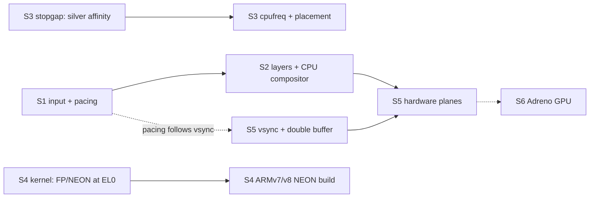

# Smooth UI: from 15 fps redraws to 60 fps on the Pixel

**Status: in progress. S1 and S3 are done (2026-11-08); S2 is in progress (S2b, screen-change fades, is in code);
S4–S6 are open.** The plan (2026-11-07) comes from a
read-through of neoui, e32-rs and the kernel after the R9 speed measurements
([rust-integration.md](rust-integration.md#r9-neoui-speed-on-the-phone-measured)). Stages S1–S6 below are the work
list. Each stage has an owner, an exit check, and an **estimate** of what it gains. Estimates are not measurements
until the stage's exit check says so.

Paths name the repository first (`neoui`, `e32-rs`, `kernel`), then the path inside it.

## Goal and budget

- **60 fps = 16.7 ms per frame**, at the user side's 1080×1800 on the Pixel.
- **Today** (R9, silver cores):
  - a full frame takes 60–68 ms to render;
  - menu ↔ home transition frames take up to 140 ms on silver and 467 ms on gold;
  - the copy of a full frame to the framebuffer takes **4 ms**.
- **The key fact:** copying finished pixels already fits the budget four times over. Drawing them every frame does
  not. Smooth phone UIs (iOS, Android, Symbian^3's own NGA) draw content once into layers and animate the layers.
  neoui redraws everything, every frame.

## Why it isn't smooth

| # | Problem | Evidence | Owner |
|---|---|---|---|
| 1 | One full render per input event. A drag sends one move every 10 ms, and each move is followed by a render of 60+ ms. | `neoui` `symbian/src/lib.rs`, the `rt::select` loop in `main` | neoui |
| 2 | The kernel's event queue holds 40 events and **drops new ones when full**. That loses Up events: "a press paired with a later release" (R9). | `kernel` `kernel/eka/kernel/sinit.cpp:46` (`KMaxEventQueue=40`), `kernel/eka/kernel/eventq.cpp` `Kern::AddEvent` | kernel |
| 3 | Frame pacing is a fixed 33 ms wait *after* the render, so the frame period is render + 33 ms, and fps can never pass 30. | `neoui` `symbian/src/lib.rs` `FRAME_US` | neoui |
| 4 | Nothing is kept between frames. Home page swipe, menu ↔ home fade and every list scroll redraw the whole area each frame. | `neoui` `ui/screens/home.slint:141` (`animate x`), `ui/shell.slint:35` (`animate opacity`), 21 `Flickable`s in `ui/screens/` | neoui |
| 5 | CPU clocks are never set. The gold cores run 2.2× *slower* than silver, probably left at a low clock by ABL (unverified). | `kernel` `baseport/arm64/common/specific/a64_variant.cpp:91` (hard-coded nominal clock) | kernel |
| 6 | Threads move freely across all 8 cores, so neoui lands on the slow gold cores. The balancer ignores core capacity. | `kernel` `kernel/eka/kernel/sthread.cpp:614` (`KCpuAffinityAny`), `kernel/eka/nkernsmp/nk_bal.cpp` | kernel |
| 7 | No FP/NEON for user code: CPACR_EL1 is never set, and no V registers are saved on a context switch. This forces the soft-float ABI and an ARMv5TE build. | `kernel` `kernel/eka/nkernsmp/arm64/vectors.S` (x0–x30 only), `a64s_ncsched.cpp:560` (`CompleteContextSave` stub) | kernel |
| 8 | The ARMv5TE build has no NEON, no LDREX/STREX and no hardware divide. Atomics and locks go through the kernel: every Rust alloc/free makes 2 exec calls, and euser's `RFastLock` uses SWP, which ARMv8 traps and the kernel emulates. | `e32-rs` `crates/e32/src/heap.rs` (`mutex_wait`/`mutex_signal`); `kernel` `kernel/eka/kernel/arm64/a64e_a32fix.cpp` `EmulateSwp` | e32-rs, kernel |
| 9 | One uncached framebuffer with no vsync, no flip and no double buffer, so updates can tear and there is nothing to pace frames against. | `kernel` `baseport/arm64/common/specific/a64_display.cpp:124` (`EMapAttrBufferedC`); no MDP/DPU register is touched | kernel |
| 10 | Touch is polled every 10 ms over 100 kHz I2C with a busy spin. Every press and release calls `Kern::Printf`, which prints with interrupts off. | `kernel` `baseport/arm64/bonito_variant/specific/a64_touch.cpp:282` (`KPollMs`), `:345` (the print); `baseport/arm64/sdm670_assp/qcom_geni_i2c.cpp` | kernel |

**Correction to R9's "next" list:** Slint's software renderer draws pixels with integer math. In
`i-slint-renderer-software` `draw_functions.rs`, only radial and conic gradients use `f32`, and neoui uses neither.
Hardware floats speed up layout and per-item math, not per-pixel drawing. So they rank below S1–S3, not second. The
NEON and LDREX gains of S4 still count.

**Ruled out:**
- user memory is write-back cached, inner shareable;
- caches and MMU are on for all cores;
- ASID context switches with no cache maintenance;
- no tracing compiled in;
- no demand paging;
- unaligned ordinary loads and stores are handled in hardware (`SCTLR.A=0`).

## Stages

### S1: input and frame pacing

**Owner:** neoui + kernel. **Status: done (2026-11-08)**, in `neoui` `f1a844b` and `kernel` `38eb607`. Checked on
the Pixel; Syborg CI not run (being rebuilt).

- **neoui main loop** (`symbian/src/lib.rs`):
  - after the first event wakes the loop, it takes every queued event without waiting (a fresh `RequestEvent`
    completes at once when the kernel has one);
  - runs of pointer moves fold into the last one; Down, Up and keys are never merged (`neoui-proto`
    `coalesce_moves`, host-tested);
  - all events are handled, then the UI renders **once**.
- **Pacing:**
  - frames start on a 16.7 ms grid (`FRAME_US`), not 33 ms after the render;
  - a frame that overruns skips the starts it missed (`neoui-proto` `next_deadline`).
- **Logging:** each release logs its own press (`neoui: tap X,Y down Some((X0, Y0))`). One frame can show
  several taps, so `tap from … redrew` names the last one.
- **Kernel:**
  - `KMaxEventQueue` 40 → 256 (`kernel/eka/kernel/sinit.cpp`);
  - the touch driver prints only the first 10 presses and releases, and counts events the full queue refused;
    the monitor's `touch` shows `presses+releases N, events dropped N`;
  - the monitor's `swipe x1 y1 x2 y2 [moves [ms]]`: `swipe 900 900 180 900 600` is a 10 s drag.
- **Exit check (Pixel, `phone.py`, RAM boots):** passed.

  | Run | Releases paired with their own press | Screen changes | Events dropped | Frames/s while dragging |
  |---|---|---|---|---|
  | Before (R10 `fc54289`, kernel `f93a432`): 20 short swipes + 20 taps | 21 / 40 seen, swipes mostly lost | 17 / 20 | not counted | 8 |
  | After, scripted: two 10 s drags + 20 taps | 22 / 22 | 20 / 20 | 0 | 28–42 |
  | After, by hand: swipes + taps through the apps | 28 / 28 (driver: 28 touches) | one per tap on a button | 0 | — |

  - No `neoui: perf` line passes 60 frames per second.
  - The render times aren't comparable across runs: the scheduler puts neoui on gold (CPU 6, 4–8 fps) or silver
    (CPU 0–2, 25–42 fps) at random. That is S3.
  - Since kernel `2692bea` the user side is 1080×2160: Apps is at (540, 2000), Back at (174, 2068).
- **Gain (measured):** no lost taps. Touch is drawn at the next frame, not after a backlog.

### S2: retained layers and a CPU compositor

**Owner:** neoui. **Status: in progress.** S2b (screen-change fades) is in `neoui` `7cce590`, `16958f7` and
`f3ad55c` (e32-rs `e97e2eb`), checked on Syborg only; the phone check and S2c–S2e are open.

- The UI server keeps **layers**: off-screen XRGB8888 buffers that each hold a fully drawn screen, home page or list
  strip.
- **Animations stop redrawing and only copy:**
  - **screen transitions** (menu ↔ home, open/close app): draw the target screen once, then animate by copying both
    layers at offsets (slide) or blending them (fade);
  - **home page swipe:** the pages as one wide layer, copied at the finger's offset;
  - **list scroll:** copy the existing content up or down with `copy_within`, and draw only the newly exposed strip.
- **S2a, design (screen changes):** the server snapshots the screen before the switch (the second option below). Slint
  keeps its one `MinimalSoftwareWindow`. Still open for S2c/S2d, whose layers live inside one screen:
  - a Slint window per layer (the platform's `create_window_adapter` can return several);
  - handling scrolling in the server instead of in Slint's `Flickable`.
- **S2b, screen changes fade from snapshots** (`7cce590`):
  - Before: Slint's 250 ms fade + 16 dp rise (`Slot`) redrew both full screens every frame, 50–55 ms a frame on
    boosted gold (S3).
  - Now, before a change, the server snapshots the screen: the shell frame with the front app's surface over its
    body. Slint switches at once (`Shell.server-transitions` → `Theme.instant`, 0 ms `Slot` animations). One render
    leaves the new screen in the frame. For 250 ms the server then blends old and new row by row straight to the
    framebuffer, the new body rising 16 dp with ease-out-quad.
  - `neoui-render` `src/layer.rs`: `blend_row` (integer, no divide), `ease_out_quad`, `Transition`, host-tested
    against a per-channel reference. `tests/transitions.rs`: with the flag on, one render after a switch redraws the
    whole body and leaves nothing to animate.
  - The desktop host, snapshot tests and tests keep Slint's own fade (the property defaults to off).
  - `neoui: perf` counts composed frames apart: `N layer frames avg … max … us`, after the fields CI greps.
  - **Memory** (`16958f7`, `f3ad55c`): a 1080×2160 snapshot is 9,331,200 bytes.
    - Allocating it at start-up crashed the Pixel: SYSSTART panicked, the kernel faulted, the phone restarted.
    - Now `try_reserve_exact` takes it when a fade starts, a running fade reuses it, and it is freed when the fade
      ends. When it can't be had, the log says `neoui: no memory for a fade` and the new screen just appears.
    - With e32's 16 MB heap that happened on every change (seen on the installed slot b), so e32-rs `e97e2eb`
      reserves 64 MB.
  - **Checked on Syborg** (native QEMU on the Mac): one Slint render + 11–12 composed frames per screen change; a
    mid-fade screenshot shows the cross-fade. At 1080×2160 with the 64 MB heap: menu ↔ home fade, 9 composed frames
    each.
  - **Not checked on the Pixel:** slot b has neoui `16958f7` with e32 `c5fda36`, so its screen changes appear without
    a fade. Layer-frame timing on the phone is not measured.
- **Open:**
  - **S2b on the Pixel:** RAM-boot neoui `f3ad55c` or later; menu ↔ home; read the `layer frames` line; then install
    it into a slot.
  - **S2c, home page swipe:** the pages as one wide layer.
  - **S2d, list scroll:** shift with `copy_within`, draw only the exposed strip.
  - **S2e, app surfaces** (R6) are layers already. Bring them into the same compositor.
  - Syborg CI on the S2 commits.
- **Exit:**
  - menu ↔ home, home swipe and a menu scroll each log `neoui: perf` render+copy ≤ 16.7 ms per frame on the silver
    cores;
  - Syborg CI still passes.
- **Gain (estimate):** the main one. These animations go from ~15 fps to the copy speed (4 ms for a full frame).

### S3: CPU placement and clocks

**Owner:** kernel; overlaps [roadmap.md](roadmap.md) M4. **Status: done (2026-11-08)**, in `kernel` `6ca665a` (S3a),
`a584295` (S3b), `9b127ce` (S3c) and `618a9d9` (S3d). Checked on the Pixel and on QEMU. Clock policy chosen by the
owner: touch boost.

- **S3b, the clocks ABL leaves** (monitor `cpus`: PMU cycles against `CNTVCT` per CPU; `EL2` does not trap the
  PMU; OSM registers read with `peek`):

  | Block | Core (MIDR part) | ABL's step | Clock (PMU) | Top step |
  |---|---|---|---|---|
  | Silver, CPUs 0–5 (cpufreq domain 0, `0x17d43000`) | Kryo 385 Silver, `0x803` (A55) | 8 of 0–8 | 1708 MHz | 1708.8 MHz |
  | Gold, CPUs 6–7 (domain 1, `0x17d45800`) | Kryo 385 Gold, `0x802` (A75) | **0** of 0–9 | **300 MHz** | 1996.8 MHz |
  | L3 (osm-l3, `0x17d41000`) | — | 5 of 0–10 | 940.8 MHz | 1440 MHz |

  - That is why gold rendered 2.2× slower than silver in R9: it ran at a sixth of silver's clock.
  - The OSM register layout is Linux `qcom-cpufreq-hw.c` (sdm845): LUT at +0x110, 32-byte rows, `LVAL` × 19.2 MHz,
    PERF_STATE at +0x920.
- **S3a, stopgap:** the board sets the user threads' default CPU affinity (`A64_UserCpuAffinity` in `board.h`, used
  in `sthread.cpp`). The Pixel kept them on CPUs 0–5 until S3d.
- **S3c, cpufreq with touch boost:** `baseport/arm64/sdm670_assp/qcom_cpufreq.cpp` reads the three step tables.
  - Every input event (`Kern::AddEvent` → `A64CpuBoost`) puts silver, gold and L3 at their top steps.
  - 3 s after the last event they go back to ABL's steps.
  - The monitor's `cpufreq` shows each block's step; the HAL's `ECPUSpeed` reports gold's top step.
- **S3d, placement by capacity:** each balancing pass in `nk_bal.cpp` scales a CPU's share by `A64CpuCapacity`, which
  is DTB `capacity-dmips-mhz` (silver 610, gold 1024) × the clock now.
  - Gold boosted: 1024. Silver: 522. Gold at 300 MHz: 153.
  - So busy threads move to gold while the user touches the phone, and stay on silver otherwise.
  - Boards without cpufreq get 1024 for every CPU (QEMU, nkernsa: unchanged). User threads may run anywhere again.
- **Exit check (Pixel):** passed.

  | Run (two 10 s drags + 20 taps) | neoui on | Frames/s while dragging | Render | Input |
  |---|---|---|---|---|
  | S1 only (`38eb607`) | CPU 0–2 or 6 at random | 4–8 on gold, 25–42 on silver | 21–140 ms | 22/22 paired |
  | S3a (silver only) | CPU 5 | 35–41 | 31.2 ns/px | 22/22 paired |
  | S3d (boosted gold) | CPU 6–7 | 37–62 | **17.7 ns/px** | 22/22 paired, 0 dropped |

  - Gold ns/px < silver ns/px, the exit condition.
  - 5.5 minutes of drags and taps: no reset, gold still at 1996 MHz at the end (no LMh throttling seen), 70/70
    releases.
  - Menu ↔ home transitions still take 50–55 ms a frame on gold (full redraws): S2's job.
- **Not done:** DDR / memnoc votes (RPMh BCM `MC0`/`SH0` + `ACV`). A full-frame copy takes 4 ms, so bandwidth isn't
  the limit yet; `qcom_rpmh.cpp` can't express ACV's bitmask. Lowering silver when idle, a governor and a thermal
  driver belong to power (H3).
- **Gain (measured):** gold went from 300 to 1996 MHz under touch; rendering is 1.8× faster per pixel than on silver
  and about 5.6× faster than gold before (R9: about 100 ns/px).

### S4: FP/NEON for user code and an ARMv7/ARMv8-AArch32 build

**Owner:** kernel session first, then e32-rs and neoui. **Status:** not started.

- **Kernel:**
  - set CPACR_EL1.FPEN for EL0;
  - save and restore V0–V31, FPSR and FPCR on a context switch (lazily: trap on first use per thread);
  - check whether Qualcomm's EL2 traps AArch32 FP (`CPTR_EL2`, `HCR_EL2`).
- **Rust:**
  - a custom target for ARMv7-A or ARMv8 AArch32 with NEON that keeps the **soft-float calling convention**
    ("softfp"), so calls into the 2010 libraries stay compatible;
  - fix the inline-asm block that needs VFP register `s0` (R9's blocker);
  - with LDREX/STREX available: user-side atomics, a heap lock without exec calls, and no SWP traps in Rust code.
- **Exit:**
  - neotest passes on Syborg and on the Pixel;
  - ns/px and allocations per frame are measured before and after.
- **Gain (estimate):** NEON-vectorized fills, blends and copies, and cheap locks; maybe 1.5–2× on render. Floats help
  layout only.

### S5: the display processor (DPU)

**Owner:** kernel session (driver), then neoui (planes in the compositor). **Status:** not started; needs facts first.

- **Step 1, vsync and double buffer:**
  - take the DPU's vsync interrupt;
  - flip between two framebuffers by changing the source pipe's address;
  - the user side gets a "next vsync" wait and a "present buffer N" call.
  - Result: no tearing, and the 16.7 ms pacing from S1 follows the real panel.
- **Step 2, hardware planes:**
  - the DPU blends several source pipes (SSPPs) during scan-out, each with its own address, crop, position and alpha;
  - map the compositor's layers onto them: status bar, body or app, keyboard, the incoming screen in a transition;
  - a fade or slide then costs **no CPU**: change a plane's alpha or position at each vsync.
- **Optional:** render at a lower resolution and let a VIG pipe upscale it.
- **Reference:** Linux `drivers/gpu/drm/msm/disp/dpu1`. Its hardware catalog has an SDM670 entry (to verify) that
  gives the pipe count and register offsets.
- **Facts needed first:**
  - panel video mode or command mode (from the phone's DTB);
  - which pipe ABL's continuous splash uses.
- **Exit:**
  - a scroll test shows no tearing;
  - a menu ↔ home fade runs at 60 fps with zero render frames during the fade.
- **Gain (estimate):** tear-free output; transitions with no CPU cost; CPU free for drawing content.

### S6: Adreno 615 GPU (stretch)

**Owner:** kernel + a Rust command-stream builder. **Status:** not planned; this is [roadmap.md](roadmap.md) U4.

- Needs:
  - the GMU and its firmware;
  - the SQE microcode;
  - the zap shader loaded through TrustZone;
  - an SMMU context;
  - then a renderer.
- Mesa can't run on the 2010 user side. Freedreno is the reference.
- Worth it only for 3D or heavy effects. For a 2D phone UI, S2 and S5 cover the need.

## Order

| Step | Stages | Who | Checkpoint |
|---|---|---|---|
| 1 | S1 ✅ | neoui (+2 kernel lines) | No lost taps; touch follows the finger (done 2026-11-08) |
| 2 | S2 (S2b in code) | neoui | Transitions, swipe and scroll at 60 fps on silver |
| 3 | S3 ✅ | kernel session | UI on the fast cores; gold faster than silver (done 2026-11-08) |
| 4 | S4 | kernel session, then e32-rs/neoui | NEON build; cheap locks |
| 5 | S5 | kernel session, then neoui | No tearing; free fades and slides |
| — | S6 | later | Only if 3D is needed |

## Unverified: check before the stage that needs it

| Item | Needed by | How |
|---|---|---|
| ~~Real CPU clocks after ABL~~ (S3b: silver 1708, gold 300 MHz; the PMU is not trapped). DDR clock | S3 | DDR: not measured yet |
| Panel video vs command mode; which pipe the splash uses | S5 | The phone's DTB (`private/bonito.dtb`), DPU register dump |
| AArch32 FP traps at EL2 (Qualcomm hypervisor) | S4 | Enable FPEN, run one VFP instruction at EL0 |
| How often alignment (LDRD/LDM) and SWP traps fire | S4 | Counters in `a64e_a32fix.cpp` |
| SDM670 entry in Linux's DPU catalog | S5 | Read `dpu1/catalog/` in a current kernel tree |
| Every gain estimate above | each stage | The stage's exit check |
