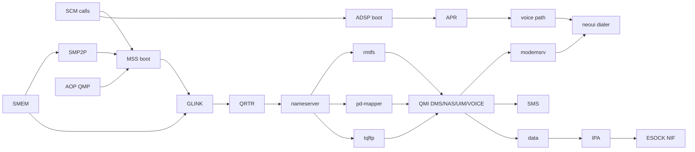

# Telephony: cellular calls, SMS and data on the Pixel 3a XL

Written 2026-11-08. This file is the end-to-end runbook for roadmap Track P: from a silent modem to a phone that
places and takes calls, sends SMS and uses mobile data. It replaces the outline in `roadmap.md` Track P.

Each stage gives its goal, the work, the exit test, and the failure modes we know of. It gets updated at the end of
every stage with what really happened.

- Facts marked **DTB** come from the mainline bonito device tree (the ztOS boot.img, `~/WS/ztOS/…/sdc/boot.img`).
  Dump it with `dtc -I dtb -O dts` after the `d00dfeed` magic.
- **Linux** facts are taken from the mainline drivers named next to them. They describe protocol behaviour and are
  used as reference ([Sources and licences](#sources-and-licences)).
- **unverified** means not checked yet. Stage C1 is meant to check most of them.

## Decisions

| Decision | Made by | Choice |
|---|---|---|
| Networks | user | The SIM's network has 3G and 4G/VoLTE. |
| First milestone | user | A full voice call: dial and answer, two-way audio through the earpiece and the mic. |
| Calls on 4G | **my call** | The modem registers on LTE and uses **CSFB** for calls: it drops to 3G for the call by itself, with no IMS needed. VoLTE is a separate stretch stage (C11). |
| Symbian stack | **my call** (user: "you decide") | A Rust `modemsrv` server plus neoui apps, **no ETel at first**. The 2010 Phone app needs the classic Avkon UI, which neoui replaced. A thin ETel TSY over `modemsrv` comes in C12, only if old apps need it. |
| Language split | roadmap | Transport (SCM, SMEM, SMP2P, GLINK, remote-processor boot, IPA rings) is kernel C++. Protocols (QRTR, QMI, rmtfs, pd-mapper, tqftp, APR, call logic) are user-side Rust. |
| Sources | user: "any option, prefer our own" | Our own code first. The BSD-3 linux-msm tools can be ported closely, with attribution. GPL Linux drivers are reference only. If a piece stalls, porting the GPL driver directly is allowed: that file then carries a GPL-2.0 header and is listed in [Sources](#sources-and-licences). |
| Firmware | **my call** | Qualcomm's signed firmware is read at runtime from the phone's own `modem_a` and `dsp_a` partitions. It never goes into a repo or a ROM. |

## Safety rules

- **Gate G4** (new; the other gates are in `filesystem.md`): any write to `modemst1`, `modemst2`, `fsg`, `fsc`,
  `modemcal`, `persist` or `modem_a/b` needs the owner's OK at the time. Until G4, rmtfs keeps the modem's EFS writes in
  RAM.
- Back up the radio partitions (C0) before the first modem boot of any OS.
- Never put the IMEI, ICCID, IMSI, phone numbers or the DTB in a repo or a committed log. Monitor commands print
  them masked (`35xxxxxxxxxxx12`).
- Don't rely on this phone for emergency calls.

## Hardware facts (DTB)

| Block | Facts |
|---|---|
| **MSS (modem)** | `qcom,sdm670-mss-pil`. QDSP6 registers at `0x4080000`, RMB at `0x4180000`. Watchdog = SPI 266. fatal / ready / handover / stop-ack / shutdown-ack = smp2p-mpss inbound bits 0 / 1 / 2 / 3 / 7. The stop request is outbound bit 0. |
| MSS clocks | GCC: iface, bus, mem, gpll0_mss, snoc_axi, mnoc_axi, prng; plus RPMh xo |
| MSS power and reset | Power domains rpmhpd cx, mx, mss. Resets: AOSS `0xc2a0000` `mss_restart`, PDC `0xb2e0000` reset 9. Halt registers in TCSR `0x1f60000` at +0x3000 (q6), +0x5000 (modem), +0x4000 (nc). Needs an AOP QMP message (`qcom,qmp`) |
| MSS memory | mba `0x95600000` + 2 MB, mpss `0x8b000000` + 0x9800000 (152 MB) |
| Firmware | `modem_a` (FAT16, 4096-byte sectors) holds only the modem: `IMAGE/MBA.MBN`, `MODEM.MDT` + `MODEM.B00`–`B30`, `MODEMR.JSN` (root PD, QMI instance 180), `QDSP6M.QDB`. Build MPSS.AT.4.0.2.c4.1-00120, radio `g670-00145-220106-B-8048689` (2022-01-06). **There is no `dsp_a`**: the ADSP firmware, the `mcfg` carrier profiles and `ipa_fws` sit on `vendor_a` (`/vendor/firmware`, **unverified**), taken from Google's factory image of that radio build. Linux names: `qcom/sdm670/sargo/{mba,modem,adsp,ipa_fws}.mbn` |
| **SMEM** | `0x86000000` + 2 MB, hwlock = TCSR mutex 3 |
| **APCS IPC** | `0x17990000`; doorbell register +0xc. Bits: AOP QMP 0, modem GLINK 12, modem SMP2P 14, ADSP GLINK 24, ADSP SMP2P 26 |
| GLINK edges | modem: SPI 449, remote pid 1. lpass (ADSP): SPI 170, remote pid 2 |
| SMP2P | mpss: SMEM items 435 (out) / 428 (in), SPI 451. lpass: items 443 / 429, SPI 172. Entries "master-kernel", "slave-kernel", "ipa", "sleepstate" |
| **AOP QMP** | `0xc300000`, SPI 389, mbox bit 0 |
| **rmtfs** | `0xfc201000` + 2 MB (guard pages on both sides), client-id 1, VMID 15 (MSS_MSA) |
| **ADSP** | `qcom,sdm670-adsp-pas` at `0x62400000`, memory `0x95800000` + 0x2200000. Watchdog SPI 162; fatal/ready/handover/stop-ack = smp2p-lpass bits 0–3. APR on GLINK channel `apr_audio_svc`, protection domain `avs/audio` (`msm/adsp/audio_pd`). ACDB name `Global_cal.acdb` |
| **Audio codec** | Digital: `qcom,sdm660-wcd-digital-codec` at `0x62ec0000`, mclk 9.6 MHz. Analog: `qcom,pm660l-wcd-analog-codec` on SPMI at 0xf000 (earpiece, headphones, speaker driver, mic bias; 14 IRQs). Sound card `qcom,sdm660-sndcard`, routing PDM_RX1–3, PDM_TX, AMIC2, MIC BIAS External2/Internal1 |
| **IPA** | `0x1e40000` (+gsi `0x1e04000`), IRQs SPI 311 / 432 and smp2p ipa bits. SMMU stream IDs 0x720/0x722. Carve-outs ipa-fw `0x97a00000`, ipa-gsi `0x97a10000` |
| Other carve-outs | hyp `0x85700000`, tz `0x86200000`, cdsp `0x94e00000`, wlan-msa `0x94d00000`, spss `0x97b00000`, qseecom `0x9e400000` |

## The bring-up chain

## Stages

| Stage | What | Exit |
|---|---|---|
| C0 | Recon and backups | Radio partitions backed up and hashed; carve-outs safe |
| C1 | Linux reference run | A call on this phone and SIM under mainline Linux; traces captured |
| C2 | Kernel transport | SMEM, SMP2P, GLINK working on the phone |
| C3 | Modem boot | The modem reports ready and says QRTR HELLO |
| C4 | Modem services | Modem stays up; DMS returns the revision |
| C5 | QMI + modemsrv + dialer | Calls ring and can be answered, with no audio yet |
| C6 | Call audio | **Two-way call audio on the earpiece: the first win** |
| C7 | Complete calls | Ringtone, speaker, in-call controls, crash recovery |
| C8 | Call log and contacts | Names on incoming calls |
| C9 | SMS | SMS round-trip, Unicode |
| C10 | Mobile data | HTTP over LTE |
| C11 | VoLTE (stretch) | A VoLTE call, or a recorded no-go |
| C12 | Persistence, power, compatibility | EFS persists (G4); idles overnight and still rings |

Sizes are a **GUESS**: C0–C1 2–4 days, C2–C3 1–2 weeks, C4–C5 1–2 weeks, C6 2–4 weeks, C7–C8 2–3 weeks, C9 1 week,
C10 2–3 weeks, C11 open, C12 1–2 weeks.

### C0: recon and backups

1. **Look for older backups first.** ztOS and Droidian ran on this phone before. If a dump of the radio partitions
   exists, compare hashes.
2. **Dump the radio partitions read-only:**
   - Partitions: `modemst1`, `modemst2`, `fsg`, `fsc`, `persist`, `modem_a`, `dsp_a`, plus `vendor_a` for audio facts.
   - How: a new monitor command `blk dump <part> <offset> <len>` streams the bytes over the USB console to
     `phone.py`, with a SHA-256 per partition (the CPU SHA-256 from kernel `fc4ab26`).
   - Where: `private/radio-backup/` on the Mac, never a repo.
   - Partition names and LBAs come from the GPT the driver already reads.
3. **List the firmware on the Mac:**
   - `modem_a` is FAT. With mtools, list `image/`: mba, the modem mdt/bNN files, `*.jsn`, `mcfg`, `qdsp6m.qdb`.
   - `dsp_a` the same way.
   - `vendor_a` is ext4: use `debugfs` to pull `etc/mixer_paths*.xml`, `etc/audio_platform_info*.xml` and
     `etc/acdbdata/*`.
4. **Check the carve-outs.** The table above lists them. Check that the Symbian RAM allocator never hands any of them
   out: the RAM banks in `bonito_variant/specific/pixel_bonito.cpp`, and the lastlog ring at `0x9e3e0000`, which sits
   just below qseecom.

Exit: hashes recorded in `private/radio-backup/SHA256SUMS`. The firmware file list and the carve-out check go into
this file.

**Done 2026-11-08** (kernel `1253e70` + `5c65051`):
- `blk dump <lba> <n>` (monitor) and `phone.py dump <partition> <file>`: 2.0 MB/s over the USB console, SHA-256 checked
  on the phone and on the Mac.
- No older backup existed.
- Backed up, hashes matching: `modemst1`, `modemst2`, `fsg`, `fsc`, `modemcal` (radio calibration, not in the first
  list), `persist`, `modem_a`, `bluetooth_a`.
  - `vendor_a` is not dumped: it comes from Google's factory image instead.
  - Test image: `USERSIDE=0 AUTOFASTBOOT=3600`, kernel only, eMMC read-only.
- GPT sectors:

  | Partition | Sectors |
  |---|---|
  | fsg | 27432..31527 |
  | modem_a | 299816..525095 |
  | modem_b | 525096..750375 |
  | fsc | 996480..996735 |
  | modemst1 | 1029632..1033727 |
  | modemst2 | 1033728..1037823 |
  | persist | 1037824..1119743 |
  | modemcal | 1123584..1127679 |
  | vendor_a | 14214144..15787007 |
  | bluetooth_a | 992384..994431 |

- Carve-outs: safe. Symbian's only RAM bank ends at `0x85700000` (`A64_BOOT_RAM_END`, hyp-mem), below every
  modem/DSP region. The lastlog ring ends exactly where qseecom starts. Any later growth of the bank must skip the
  carve-outs.
- Gate G4 now also covers `modemcal`.

### C1: Linux reference run (throwaway)

Why: it proves the network, the SIM and the firmware work on this phone before we write our own code. It also gives
us the exact sequences to reproduce.

- **Image:** a RAM-boot image with the ztOS mainline kernel and an initramfs-only root. It must not touch userdata,
  which holds NeoSymbian's C: and E:.
  - qrtr-ns and pd-mapper are in-kernel (ztOS `FIXES.md` #9).
  - Userland: tqftpserv, `rmtfs -o /run/rmtfs` on **copies** of the C0 dumps (the eMMC stays untouched),
    ModemManager + `qmicli` + `mmcli`, and the pmOS `ucm2/Google/sargo` VoiceCall profile.
  - Firmware: `modem_a` and `dsp_a` mounted read-only at the paths the kernel expects.
- **Tests:**
  1. register on 3G and LTE;
  2. outgoing and incoming calls (`mmcli -m 0 --voice-create-call`);
  3. SMS both ways;
  4. a data session;
  5. check whether call audio works on mainline sdm670 (**unverified**: voice needs a q6voice driver, which may be
     missing).
- **Capture, as facts for later stages:**
  - `dmesg` with `dyndbg` on `qcom_q6v5_mss`, `qcom_q6v5_pas`, `qcom_glink_smem`, `qcom_smp2p`: the order of the
    steps and the RMB status values;
  - `qrtr-lookup` (service, version, instance, node, port);
  - `qmicli -v` hex dumps for DMS/NAS/UIM/VOICE/WMS/WDS, saved as test vectors;
  - the APR traffic and the codec register writes (debugfs regmap), if audio works.
- **Go/no-go:** if Linux can't place a call with this SIM, find the cause first (network, firmware, provisioning).
  Don't write C2+ against an unknown.

### C2: kernel transport

All files are in `kernel/baseport/arm64/sdm670_assp/`. Every file is our own C++, with an Apache-2.0 header and
"Written from the protocol as described by Linux `<file>`" in the comment.

| File | Work |
|---|---|
| `qcom_scm.cpp` | SMCCC SIP calls to TrustZone: yielding SMC64 with function id `0x42000000 \| (svc << 8) \| cmd`, x1 = arg info, plus an indirect buffer for more than 4 args. Calls: `assign_mem` (svc 0x0c cmd 0x16, the hypervisor memory ownership change), PAS `init_image` / `mem_setup` / `auth_and_reset` / `shutdown` / `is_supported` (svc 0x02, cmds 1/2/5/6/7). |
| `qcom_smem.cpp` | Map SMEM uncached. Header, partition table (the last 4 KB), per-host-pair partitions (apps=0, modem=1, adsp=2), item get/alloc under TCSR hw mutex 3. |
| `qcom_ipc.cpp` | APCS doorbell writes. GIC SPIs 449/451/170/172/389 routed to a DFC per edge. |
| `qcom_smp2p.cpp` | Outbound entry creation, inbound bit changes to callbacks. Used for MSS/ADSP state, later IPA. |
| `qcom_qmp.cpp` | AOP QMP message RAM at `0xc300000`: link up, then text messages such as `{class: image, res: load_state, name: modem, val: on}`. |
| `qcom_glink.cpp` | GLINK over SMEM: the TX/RX FIFOs from SMEM items 478/479/480 in the remote's partition; version negotiation, open/open-ack by channel name, intents, TX_DATA (with chunking), RX_DONE. |
| LDD `glink.ldd` | User-side channel API: `Open(edge, name)`, `Read`, `Write`, notify on receive. User-side Rust can then speak any GLINK channel. |

Monitor commands: `smem [item]`, `smp2p`, `glink`, `qmp <msg>`.

Exit: on a phone RAM boot, `smem` lists the partitions and the items written by the boot chain, with no modem
running yet.

Failure modes:
- SMEM partition not found: the host IDs are wrong, or the table is read cached.
- `assign_mem` returning an error: wrong VMID list or alignment. Compare with the C1 trace.

### C3: modem boot

`qcom_mss.cpp`, the q6v5 **MBA** flow (Linux `qcom_q6v5_mss.c`, SDM845-family data):
1. QMP `load_state modem on`. RPMh votes cx, mx, mss (reuse `qcom_rpmh.cpp`). Enable xo, prng and the active clocks.
2. Deassert the resets (`mss_restart`, PDC reset). Clear the TCSR halt requests.
3. Copy `mba.mbn` into the mba carve-out, then `assign_mem` it to MSS_MSA (VMID 15). Write `RMB_MBA_IMAGE` (+0x00) =
   its address.
4. Start the QDSP6: enable the XO CBCR, `BOOT_CORE_START` = 1, `BOOT_CMD` = 1, poll `BOOT_STATUS`.
5. Poll `RMB_MBA_STATUS` (+0x0c) until it reads XPU-unlocked (1 or 2). A negative value is an MBA error code: log it.
6. Load the modem:
   1. Put the `.mdt` headers + hash segment in a buffer, assign it to the modem, then write `RMB_PMI_META_DATA`
      (+0x10) and `RMB_MBA_COMMAND` (+0x08) = 3 (meta data ready). Wait for status 3 (auth success).
   2. Copy each loadable `.bNN` segment into mpss at its offset, adding its size to `RMB_PMI_CODE_LENGTH` (+0x18).
   3. Write `RMB_PMI_CODE_START` (+0x14) and command 4 (load ready). Assign mpss to the modem.
   4. Wait for status 4 (auth complete).
7. Wait for the SMP2P **ready** bit, then **handover**: drop the proxy votes, reclaim the mba region to HLOS.
8. Stop: SMP2P stop bit, wait for stop-ack, assert the halts and resets, reclaim mpss. Used by C7 crash recovery.

Firmware path: `a64_medblk.cpp` exposes `modem_a` and `dsp_a` as **read-only** FAT drives. Its allow-list stays
write-protected. The user-side Rust `rprocd` reads the files and hands buffers to the LDD (`rproc.ldd`: `Load`,
`Start`, `Stop`, state notifications).

Exit: the "ready" fires, the GLINK edge "modem" comes up, the channel `IPCRTR` opens, and a QRTR HELLO arrives.

Failure modes:
- RMB status stays 0: the MBA never ran. Check the clocks, the resets and the QMP message.
- Negative RMB status: the MBA rejected the image. Check the hashes and the metadata buffer assignment.
- SMP2P fatal right after ready, with a crash reason in SMEM item 421 (`SMEM_SSR_REASON_MSS0`): the modem usually
  crashes when rmtfs or tqftp aren't answering (C4).

### C4: modem services (Rust, user side)

These live in the Rust workspace [NeoSymbian/telephony](https://github.com/NeoSymbian/telephony) (created 2026-11-08). Each is a
Symbian EXE in the ROM, on the `e32` crate:

| Crate | Work |
|---|---|
| `qrtr` | Router and nameserver over the GLINK `IPCRTR` channel. QRTR v1 framing, control packets (HELLO, BYE, NEW/DEL_SERVER, NEW_LOOKUP, RESUME_TX). Local clients connect over Symbian IPC. Reference: linux-msm `qrtr` (BSD-3). |
| `qmi` | QMI encode/decode (header + TLVs), transactions, indications. Service and message tables written from libqmi's JSON service descriptions (facts). Unit-tested on the Mac against the C1 hex dumps. |
| `rmtfs` | QMI service 14: open (`/boot/modem_fs1` = modemst1, `fs2` = modemst2, `fsg`, `fsc`), alloc_buf (gives the shared region `0xfc201000`), rw_iovec, get_dev_error. The kernel maps the region and assigns it to HLOS + MSS_MSA. The partitions are read once at start through a read-only raw-partition LDD op (allow-list: modemst1/2, fsg, fsc). **`shortcut:` writes stay in RAM until gate G4.** Reference: linux-msm `rmtfs` (BSD-3). |
| `pdmapper` | Service registry locator (QMI service 64): answers which protection domains run where, from the `.jsn` files on `modem_a`/`dsp_a`. Reference: linux-msm `pd-mapper` (BSD-3). |
| `tqftp` | The TFTP-over-QRTR file service the modem uses for config files: `/readonly/firmware/image/...` maps to `modem_a`, `/readwrite/...` to `C:\private\<uid>\modem` (or RAM until G4). Reference: linux-msm `tqftpserv` (BSD-3). |
| `rprocd` | Starts the remote processors at boot in order: services first, then the modem, then the ADSP. It watches for crashes. |

Exit:
- the modem stays up 10 minutes with no fatal;
- QMI DMS answers the revision and the IMEI (masked in the log);
- UIM reports the SIM present.

### C5: QMI + modemsrv + dialer (no audio)

- **QMI clients:**
  - DMS: operating mode online / low-power, revision, IMEI.
  - UIM: card status, PIN verify, ICCID.
  - NAS: system selection (auto, LTE preferred, 3G allowed), serving system, operator name, signal info,
    indications.
  - VOICE: indication register, dial, answer, end, all-call-status indication, get-all-call-info, start/stop DTMF.
- **`modemsrv`** (Rust Symbian server): owns the QMI clients. Its IPC API for apps:
  - `Status` → operator, technology (3G/LTE), bars, SIM state;
  - `Dial(number)`, `Answer`, `Hangup`, `SendDtmf`;
  - a notification stream: incoming call with number, call state changes, registration changes.
- **neoui:** the status bar shows the operator and the bars. A dial pad, the incoming-call screen, the in-call screen
  (timer, hang up).

Exit: the status bar shows the operator and the bars; an outgoing call rings the owner's other phone; an incoming call
shows the number and can be answered and hung up. This needs the owner to place and answer test calls.

### C6: call audio (= roadmap H5 for voice)

1. **ADSP boot** (`qcom_pas.cpp`): PAS flow through `qcom_scm.cpp`:
   1. QMP `load_state adsp on`, then PAS `init_image` with the `.mdt` metadata;
   2. `mem_setup`, copy the segments into `0x95800000`, then `auth_and_reset`;
   3. wait for SMP2P lpass ready and handover.
2. **Services:**
   - The GLINK edge "lpass" comes up. QRTR also runs on it, and pd-mapper must serve `avs/audio` or the audio PD
     never starts.
3. **APR client** (Rust crate `apr`) on the GLINK channel `apr_audio_svc`. APR services: CORE 3, AFE 4, ASM 7,
   ADM 8, MVM 9, CVS 10, CVP 11 (Linux `apr.h`).
   - q6core: wait for ready.
   - AFE: set the LPASS clocks (internal codec MCLK 9.6 MHz), start the RX and TX ports used by the internal codec.
     The port IDs come from C1 or the pmOS UCM.
   - Voice (Linux q6voice / Android `msm-voice` as reference):
     1. MVM creates the passive control session "default modem voice", and CVS creates the passive stream session of
        the same name;
     2. CVP creates the full control session on the RX/TX AFE ports;
     3. MVM attaches the vocproc and starts voice. The modem then streams call audio to the ADSP by itself.
4. **Codec:**
   - Digital codec registers at `0x62ec0000`: a kernel register-access LDD, or `hwaccess` if it exists by then.
   - PM660L analog codec over SPMI at 0xf000: earpiece driver and AMIC + mic bias for the primary mic.
   - The register values come from `mixer_paths*.xml` (vendor_a) and the pmOS UCM VoiceCall profile, as facts.
5. **Calibration:** ACDB is optional at first. Without it, expect quiet or echoey audio; note it in known-issues.

Fallback if this stalls: port Linux q6afe/q6voice and the msm8916-wcd codec drivers directly (GPL, allowed).

Exit: **a two-way call through the earpiece**, both directions, with the owner on the other phone.

Failure modes:
- q6core never ready: the audio PD did not start (pd-mapper), or the ADSP crashed (SMEM crash reason item for
  lpass).
- The call connects but is silent: AFE port not started, wrong port IDs, codec not powered, or MVM not attached to
  the modem session.

### C7: complete calls

- **Ringing:**
  - a ringtone file played through ASM → ADM → AFE to the loudspeaker;
  - the speaker path follows the pmOS UCM (whether it is the PM660L speaker driver or an external amp is
    **unverified**);
  - vibration through PM660 haptics (roadmap H6);
  - a missed-call notification.
- **In-call:**
  - mute (CVS mute), DTMF;
  - hold/resume, call waiting, swap and merge (QMI VOICE manage-calls);
  - a speakerphone switch (CVP device change).
- **Proximity:** the sensor is served by the ADSP sensor PD over FastRPC (ztOS needed `hexagonrpcd`), which is a large
  piece of work. **Fallback (my call):** turn the screen off when a call is answered and turn it on with the power
  key, until a FastRPC client exists.
- **Wired headset:** USB-C analog audio (the codec MBHC plus the USB PHY mux); last in this stage.
- **Robustness:**
  - On SMP2P fatal or the watchdog, `rprocd` stops the modem, reloads it and restarts the services, and `modemsrv`
    reconnects. The UI shows "no service" meanwhile.
  - Airplane mode = DMS low-power.
  - SIM PIN prompt, SIM removed and inserted.

Exit: a day of normal use with calls and no reboot.

### C8: call log and contacts

- `modemsrv` writes the call history to `C:\private\<modemsrv uid>\calls.db`.
- A small Rust contacts store, plus vCard import from `E:`. The old Symbian contacts model is used only if C12's ETel
  work makes old apps matter.
- neoui Recents and Contacts apps. The dialer and the incoming-call screen look up names.

Exit: an incoming call from a saved number shows the contact's name.

### C9: SMS

- QMI WMS:
  - receive (MT indications, read + delete from modem storage);
  - send (PDU mode, our own GSM-7/UCS-2 encoder);
  - concatenated messages, delivery reports;
  - the SMSC from the SIM.
- Messages are stored in `C:\private\<modemsrv uid>\sms\`. neoui Messages has threads and notifications.
- The Symbian SMS stack is not used.

Exit: an SMS round-trip with the owner's phone, including Armenian and Cyrillic text and a 300-character message.

### C10: mobile data

- **Control:** QMI WDS (start network interface, APN from settings), WDA (QMAP data format), and the IPA QMI
  handshake with the modem (Linux `ipa_qmi.c`).
- **Data path, kernel C++:**
  - the IPA hardware: load `ipa_fws.mbn` through PAS, GSI channels and rings, and the IPA SMMU context (stream IDs
    0x720/0x722);
  - rmnet/QMAP framing.
  - Reference: Linux `drivers/net/ipa`.
  - **Risk:** the first SMMU work in the port.
- **Symbian side:** an ESOCK/TCPIP6 packet interface (NIF) over the rmnet device. It needs `commsfw`,
  `networkingsrv` (ESOCK/TCPIP6) re-forked from `retired-repos.md`; **ask the owner first.**
- **Fallback:** a small Rust IP stack (smoltcp) behind our own socket API, if the 2010 stack costs too much.

Exit: ping and an HTTP fetch over LTE, and over 3G with LTE disabled.

### C11: VoLTE (stretch, go/no-go)

- **Question:** can the modem's internal IMS register when the carrier's MCFG profile is selected (QMI PDC), the IMS
  settings are written (QMI IMSS/IMSA), and an IMS APN data session is up (WDS)?
- **Test** on the C1 Linux setup first: how far postmarketOS sdm845-family ports have got is the reference.
- **Yes:** calls go through the same VOICE service and C6 audio path.
- **No:** record it here. Calls stay on CSFB/3G and stop working when the network turns 3G off.

### C12: persistence, power, compatibility

- **G4 (owner's OK):**
  - rmtfs writes the EFS back the way Android does: alternate between `modemst1` and `modemst2`, sync on the modem's
    request;
  - `fsg` stays read-only;
  - only after a verified C0 backup.
  - Until G4 the modem relearns its network caches every boot. Nothing else breaks.
- **Power** (needs roadmap H3 suspend):
  - drop our RPMh votes when idle;
  - the AP suspends with the modem registered;
  - SMP2P/GLINK interrupts wake it for calls and SMS.
  - Exit: idle overnight with a SIM, and an incoming call still rings.
- **ETel (optional):** if old Symbian apps need telephony, a thin C++ TSY over `modemsrv` after re-forking
  `cellularsrv` (ask first).
- **Out of scope:** eSIM, MMS, Bluetooth call audio (comes with P4 Bluetooth), emergency-call guarantees.

## Code layout

| Where | What |
|---|---|
| `kernel/baseport/arm64/sdm670_assp/` | `qcom_scm`, `qcom_smem`, `qcom_ipc`, `qcom_smp2p`, `qcom_qmp`, `qcom_glink`, `qcom_mss`, `qcom_pas`, IPA (C10), the LDDs `glink`, `rproc`, raw read-only partition op |
| `kernel/.../a64_medblk.cpp` | Read-only drives for `modem_a`/`dsp_a`; G4 write path for `modemst1/2` (C12) |
| `kernel/.../pixel_bonito.cpp` | MMU entries for SMEM, rmtfs, QMP, APCS, codec; RAM bank carve-out check |
| [`telephony`](https://github.com/NeoSymbian/telephony) (Rust) | `qrtr`, `qmi`, `rmtfs`, `pdmapper`, `tqftp`, `rprocd`, `apr`, `modemsrv` |
| `neoui` | status bar, dialer, in-call, Recents, Contacts, Messages |

## Testing

- **Rust protocol crates:** `cargo test` on the Mac, with the C1 captures as vectors (QMI, QRTR, APR, rmtfs
  requests).
- **Kernel:** each stage builds for QEMU too (`neo kernel qemu`, `neo qemu 60`), so nothing regresses. The hardware
  parts are tested on the phone:
  `AUTOFASTBOOT=600 DTB=../private/bonito.dtb neo kernel bonito`, `phone.py run IMG --stay`, then `phone.py cmd …`.
- **Calls need the owner:** the call and SMS exit tests need someone at the other phone.

## Sources and licences

| Source | Licence | Use |
|---|---|---|
| linux-msm `qrtr`, `rmtfs`, `pd-mapper`, `tqftpserv` | BSD-3-Clause | May be ported closely; keep the copyright line in the ported file |
| libqmi `data/qmi-service-*.json` | LGPL-2.1 (data) | Message IDs and TLV layouts, as facts |
| Linux `qcom_scm`, `qcom_q6v5_mss`, `qcom_q6v5_pas`, `qcom_glink_*`, `qcom_smp2p`, `smem`, `qcom_aoss`, `apr`, `q6afe`, `q6asm`, `msm8916-wcd-*`, `drivers/net/ipa` | GPL-2.0 | Reference. A direct port is allowed if a stage stalls; that file is then GPL-2.0 and listed here |
| pmOS/msm8916-mainline `q6voice` | GPL-2.0 | Reference for C6 |
| Android `mixer_paths*.xml` (phone's vendor partition) | proprietary | Register values as facts, read from the phone; never copied into a repo |
| Qualcomm firmware (`modem_a`, `dsp_a`) | proprietary | Loaded from the phone at runtime only |

Direct GPL ports so far: none.

## Status

| Stage | State |
|---|---|
| C0 | **done 2026-11-08**: radio partitions backed up, firmware listed, carve-outs safe |
| C1–C12 | not started |
